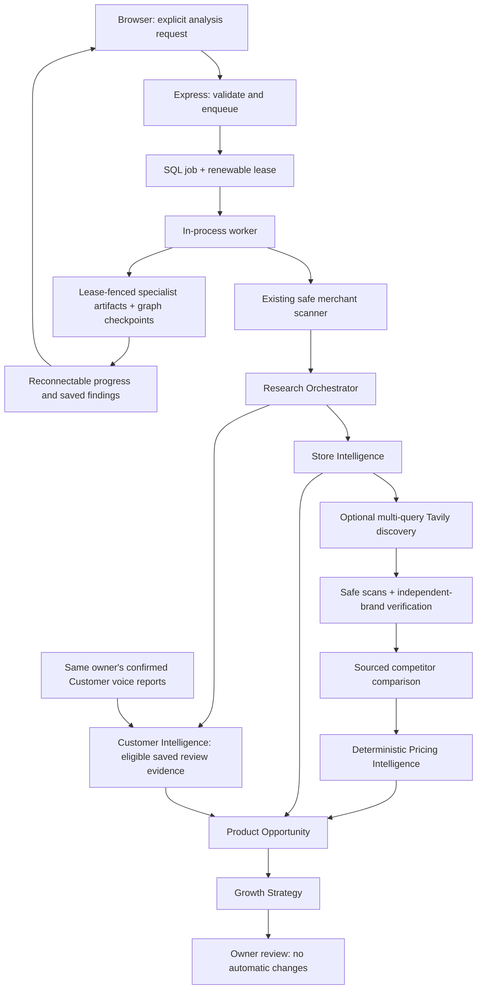

# GrowthPulse

An evidence-first business growth partner. Checkpoints 1, 2, 4, and 5 provide the
application shell, a **local SQLite business workspace with authentication**,
**safe, read-only public website scanning**, and a **unified product catalogue
with reviewed imports**. Agent-led onboarding uses the official Anthropic SDK to
call the scanner as a tool and prepare sourced business drafts for owner review.
New UI analyses include a bounded LangGraph research team and competitor
discovery through hosted Tavily MCP, with independently saved findings.
The first visit starts with an animated story, then account creation or login,
then website entry and explicit scan/analysis permission.
Scheduled monitoring and website changes are not implemented.

See [the product overview](project%20overview.md) and [the implementation
plan](plan.md) for scope and dependencies.

## Prerequisites

- Node.js 22.12+ within Node 22, matching the selected hosting runtime. Node 24
  also works locally. With nvm, run `nvm install` and `nvm use`.
- npm.

**No Docker, MySQL server, GoDaddy credentials, or AI key is required locally.**
SQLite stores this checkpoint's data in a file on your computer. The native
`better-sqlite3` dependency normally installs a prebuilt binary; platforms without
one need the compiler prerequisites reported by its installer.

## Dashboard experience

The regional-language preview has been withdrawn; the application uses its
original English interface and analysis flow. Its additive database migrations
remain compatible with already-upgraded databases and do not enable language
selection or rewrite saved reports.

The browser favicon uses the purple GrowthPulse pulse mark in `public/favicon.svg`,
linked from `index.html` and included in production builds.

Returning owners open **My growth journey**: a saved-data dashboard with their
active business, catalogue and plan counts, and a contextual next step. A
five-stage navigator on this overview connects **Understand → Discover → Decide →
Act → Review** without repeating it on every workspace or adding a second set of
chapter cards. The next step appears before this navigation. Its labels
describe saved records, partial research and owner-reported work, not a growth
score or an assertion that the entire journey is complete.

The shared **Active business** selector follows the owner across My growth journey,
Market intelligence, My growth plan, My actions, Products, Website evidence and sales tools.
Sidebar and journey links retain the business ID; changing businesses clears
product/import/action context rather than attaching it to another business.
An empty signed-in account starts with website setup without an empty business selector.
**I don't have a website** opens a visible manual name/category/description form,
without asking for the website again, and includes **Back to website setup**.
The primary setup page keeps a short, visible permission/provider/cost notice,
not a repeated analysis-details dropdown. Business details are nested inside
**My growth journey**, not a separate sidebar tab. Legacy `#business` links still
open that nested view. **Add business** starts the same guided setup.
Other pages keep only the shared business selector above their own content;
they do not fetch catalogue/plan snapshots just to repeat journey status.
**Website evidence** is the optional saved-scan history and manual rescan tool,
not another guided analysis step. It exposes captured public pages and scanner
results; the business agent remains the guided starting point.
The full weekly sales and outcome review lives in **My progress**, not on both
the overview and progress page.

**Future features** (`#future`) is a signed-in roadmap page, not a working
connector screen. It describes permission-based Instagram professional-account
and WhatsApp Business connections for businesses without websites, plus
photo-to-product drafts, connected order history, conversation insights and
scheduled weekly check-ins. All are explicitly planned; there are no connection
buttons, release-date promises or background research requests. The page links
to the existing website-free manual business setup and Contact us. It retains
the selected business in sidebar navigation without loading its private data.

Before authentication, four manually advanced animated frames introduce the
business, connected evidence, and a chosen next action, then show account creation.
Back/Next controls, progress dots, Skip intro and immediate login are available.
Reduced-motion preferences disable animations. The illustrations are not live
analysis or growth results. No website form or workspace sidebar appears before login.

Recommendations and plans live together in **My growth plan**; the former
`#opportunities` URL still redirects to `#growth`.
**Act → My actions** (`#actions`) is a separate execution workspace for the
owner's saved plan: suggested next steps, original evidence, and revision-checked
status updates. Active, completed and dismissed actions remain reviewable.
Action details separate **What to try**, distinct next steps and **How to measure
it**. Repeated titles and recommendation paragraphs are not shown again as goals
or tasks, including in older saved plans. Evidence and planning caveats remain in
a closed disclosure; this presentation does not rewrite saved plans or run AI.
Saved action cards group their strategy/work links and planning priorities.
Evidence separates source coverage, specific assumptions and expandable research
notes; generic title-only hypotheses are omitted. Optional product/simulator
buttons sit together without explanatory text between them.
Products is a separate tool, not the Act destination. Catalogue and simulator
links are optional within each action; they never infer a product match or
perform the work. Completion is owner-reported, not measured uplift.
**Market intelligence** presents saved external research. Its overview leads with
an accepted observation when available and also shows the AI's saved suggestions
and hypotheses with explicit labels and original supporting evidence. If only
brand profiles are available, it shows their names and relevance instead of a
negative market-conclusion placeholder. Research failures remain in specialist
statuses and supporting details, without a repeated generic live-progress warning.
Browsing these findings does not rerun AI or change saved reports; actions still
belong in My growth plan. Compact routes lead to Competitors, Customer voice,
Market trends, Pricing, Product landscape and Market gaps.
Verified brand profiles, one-topic comparisons, dated published
price claims and accepted gap hypotheses reuse saved research. Hypotheses are not
established demand; claims are not market share, sales or relative-price scores.
The website report does not collect customer reviews. Product-specific
**Customer voice** provides an explicitly approved collection, source-confirmation
and review-analysis workflow on the same page, as described below.
External trend datasets, continuous Market Radar alerts, price history
and manual independent-brand submission are **not implemented**.
Customer voice displays the provider/charge disclosure alongside its start action.
**Research options and details** holds scope, listing URLs and the authorized
review CSV fallback. Browsing or opening these details never starts paid research;
errors remain visible.
Full explanations and original evidence open on demand. The Store briefing and
original specialist outputs remain under **At a glance → Store briefing and saved
specialist details**, not on the Market landing page. The active business is
retained across these views.
**My growth journey → Your business** opens nested profile management;
an approved website-profile save still starts the agent.
Research views omit the extra profile, product-review, rerun and technical footer
sections. Use **My growth journey → Your business → Manage website analysis** for an optional new
analysis or profile suggestions; opening these controls does not start a paid run.
Connection failures and analysis errors remain visible, with explicit recovery.
**Products** retains the active business. Valid, unambiguous website discoveries
are saved to the catalogue with the scan, without a separate import confirmation.
**Add a product manually** stays visible; CSV and optional saved-scan repair
remain under **Manual entry and optional bulk tools**.
Browsing does not start another analysis or change the profile. Products also
upgrades legacy website discoveries from their saved scan into the catalogue.
The confirmed catalogue now opens a **product intelligence workspace**: search
and field-review filters, a selected-product diagnosis, reviewed listing drafts,
SEO readiness and product-specific recommendations that can join the Growth plan.
Source snapshots and detailed assessments expand on demand.
Product, business and marketplace AI/research actions use the explicit start,
retry or analysis button as approval, with provider/data-use and charge disclosures
beside the action, rather than a separate approval checkbox. Browsing, opening
controls and reloading saved status do not authorize a new paid request. Website
scan ownership checks, local listing-change approvals and data-import safeguards
remain separate.

**My growth plan** is a separate decision layer across saved Store,
Competitor, Customer, Pricing, Product Opportunities and Growth Strategy findings.
It brings together accepted, cited suggestions, a first recommendation to review,
on-demand strategy/evidence drawers and a persistent business-specific action plan.
The first unsaved suggestion uses a compact **Suggested experiment** card with
its strategy and explicit add-to-plan action. It is not repeated in the
remaining opportunity cards; saved actions appear only in the plan rather than
being promoted again as the same recommendation. This is not a predicted-impact
hero. Numbered Experiment/Research prefixes are omitted from
displayed recommendation titles; saved recommendations and evidence are unchanged.
The initial review order favors saved Growth Strategy synthesis, then supporting
specialists and distinct captured pages; it is not a predicted-impact score.
Owners assess potential impact, effort and time to value. Those assessments
prioritize planned work and populate the four-quadrant opportunity map.
Unassessed actions remain explicitly unassessed.

Strategies contain the saved AI recommendation plus a clearly labeled planning
scaffold, a suggested metric and an experiment proposal to refine before acting.
No new model/research call occurs when opening this tab, adding an action or
saving an assessment. Completed status is owner-reported work, not measured uplift.
Strategy drawers and saved actions share **connected action work**. After explicitly
adding an action to the plan, owners choose one product, several products, business/
website/channel work, or a new-product concept. Known product origin is preserved
as a starting target, not proof that scope is single-product. An explicit AI request
can classify other recommendations, rank evidence-backed catalogue candidates,
explain their fit, or report uncertainty without forcing a match. Owners confirm
or override scope and targets. Each AI candidate selects one issued catalogue
evidence ID; the server resolves its owning product directly, rather than trusting
a separately generated product-ID/citation pair. Unissued references, action-only
references and repeated products are rejected. Changed/deleted product evidence requires review
and renewed confirmation. Browsing never starts matching or scans.
Each catalogue product has one canonical matching reference, preventing different
excerpts from being mistaken for different products. Candidate explanations are
reviewed against their chosen excerpt; name-only matches are tentative and current
availability needs owner verification. Scope/count inconsistencies and duplicate
products have separate, content-free diagnostics and never become saved selections.
Briefing capture counts come from the application, not generated estimates.
Product rewrites must not treat truncated excerpts as incomplete live listings,
guess ambiguous ingredients, or drop the basis of published nutrition values;
short SEO drafts have deterministic price, numeric-nutrition and volatile-fulfilment
checks. Excerpts carry field/truncation metadata.
Consumer drafts also block the unresolved food-label term "Black Resin" when it is
present in captured ingredients; they do not guess a substitute. Recommendations
citing sampled excerpts cannot turn truncation into a claim that the live ingredient
list needs completing, and stock assertions require capture attribution.
A compact provider protocol is validated locally for exact, unique text paths and
per-field lengths, avoiding a full-briefing strict-schema grammar-size failure.
A deterministic fact sheet prepares bounded captured field values before prose
generation, retaining issued references, capture dates and publisher/owner attribution.
Cut-off structured fields and ingredient statements are not promoted into complete
facts. Preparation adds no paid extraction call and does not independently verify
claims or imply full-site coverage.
Narrow dietary safeguards prevent `guilt-free` from supporting `gluten-free`,
and `no refined sugar` from supporting `sugar-free`; factual nutrition-marketing
phrases such as `nutrient-rich` require attribution rather than implied verification.
A separate evidence auditor reviews
every accepted briefing, product draft and action-guidance text field, distinguishing
sourced facts from interpretations and proposals. It can correct only issued text
paths, never citations, product identity, scope or status. Corrections receive one
verification pass covering only changed fields. Each review field gets a fact sheet
from its selected citations, without the wider evidence pool; correction inputs
explicitly identify unsupported dietary claims to omit. Edits are committed only after
verification. Failed optional business sections are withheld as whole sections,
with recorded validation issues and an omission notice, provided a supported summary
or insight survives. Provider/protocol failures and a briefing without supported
findings still fail explicitly. Product analyses and action proposals require all
their mandatory fields to pass. This model-based support review is not independent
fact verification and cannot guarantee elimination of hallucinations.

**Generate action-specific steps** sends the actual saved recommendation and confirmed
target excerpts to Anthropic; it does not reuse a generic product analysis. Scope
guidance and step generation each allow up to four AI calls: one initial response
and, only for overlong strings with valid provenance, one bounded shortening
correction, an evidence review and, only when quality text was corrected, a verification
pass. The corrections cannot change scope, IDs, citations or other fields.
Provider failures and provenance errors are not retried. The UI discloses possible
additional charges before each request. Supporting steps carry server-controlled
`targetProducts` snapshots (owned IDs, exact names and fingerprints), displayed as
confirmed action targets separately from generated prose. Shortening and evidence
corrections cannot edit those identities; older saved steps remain compatible.
Steps cannot include numeric currency or percentage estimates; owners supply
current prices, costs and success thresholds instead. Draft supporting steps stay under the original action, with
owner-recorded draft/approved/implemented/result states. Recording a result requires
notes; it is not verified uplift or automatic attribution. Manual supporting steps
remain available without AI. Target changes reset unapproved action-generated
drafts; reviewed steps must be returned to draft first. Plan revisions guard
concurrent updates, and existing saved plans do not need reanalysis.

Reviewer comparisons are opt-in and never change the paid default:
`npm run benchmark:agents -- --input /local/cases.json --output /local/new-report.json --models claude-haiku-4-5,claude-sonnet-4-6 --max-calls 16`.
Inputs must follow `benchmarkCasesSchema` in `server/agent-benchmark.ts` and use
bounded public or authorized local evidence. The report separates useful accepted
fields, partial results, safe rejections and failures, and includes source excerpts
for manual audit. Literal regression checks are not proof of factual correctness.
Latency and measured tokens are reported; tokens are a cost proxy, not a billing
total. Output is created exclusively with owner-only permissions; keep reports
outside the repository. Existing reports are never overwritten.

Products separates **Work on this growth action** from **Review products independently**.
Independent product recommendations remain product-only. Owners may add one as
a separate growth action or explicitly confirm its relevance and attach it as a
draft supporting step to an existing action, without duplicating that action.
Origin, selected targets, independent suggestions and contextual AI work remain
distinct. No website publishing, content/campaign execution or product-specific
sales forecasting capability is implied; simulations still use business-level
records and owner-entered assumptions.

**My progress** (`#progress`) reviews saved action statuses, dates and the
Weekly Growth Review pilot described below. Sales-record links open the existing
sales view, while Growth Simulator remains a separate what-if tool. Neither a
completed task nor a simulation is presented as measured uplift or attribution.
The existing LangGraph research workflow and durable SQL checkpointer still run inside
the analysis worker; the saved-result Market and Growth views do not replace them.
Live analysis shows current activity, specialist statuses and source/finding counts,
without a technical step-log dropdown. Incomplete checks remain visibly flagged.
Empty recommendation cards use **Gathering evidence before your next move**.
Market cards distinguish research still running from candidate-verification or
website-reading failures, without presenting unverified leads as competitors.
Live analytics connectors and experiment execution are not implemented. Outcome
reviews require explicitly supplied sales records and an owner decision; they are
not automatic campaign attribution. Earlier plans retain their evidence snapshots when research
or the website changes; review that evidence again before acting. Concurrent stale
edits are rejected instead of silently overwriting another view.

### Marketplace Insights

Open **Market intelligence → Customer voice**, choose a reviewed catalogue product,
read the provider disclosure and select **Find customer feedback**. Collection,
automatic product matching, authorized imports and **Analyse customer feedback** are
available here; there is no separate "above" workflow to locate. For a profile
without a website, the same feedback workflow is shown directly in Market intelligence.
The page leads with matched customer takeaways and visible review quotes, with
own-product and comparable-product feedback kept separate. If no review text was
captured, it shows a clear empty state rather than treating listing descriptions,
star ratings or published review counts as feedback. Excerpts awaiting product
matching stay out of insights; **Review product matches** opens the initially
collapsed source checks. Listing facts and capture failures remain available on
demand below the feedback. Finding fresh feedback, importing reviews and running
analysis still require explicit actions.
Each takeaway identifies praise, a concern or mixed feedback, then shows a
suggested next step and expandable original supporting reviews. Repeated sample
disclaimers and informational footnotes have been removed from the customer,
market, overview, growth and product workspaces; source attribution, essential
consent, unavailable-data states, stale-evidence warnings and errors remain.
The existing Market Intelligence agent exposes a bounded LangGraph marketplace
workflow using the existing server-only Anthropic/Tavily configuration; no extra AI
provider or autonomous agent fleet is introduced.

- Automatic discovery makes at most four basic searches across Amazon India and
  Flipkart, interleaves own-product and category queries, and retains at most six
  candidate listing paths. Search titles/snippets are leads, not accepted evidence.
  If the proposed category is not supported by saved product details, discovery
  still searches the saved product name on both marketplaces, skips category
  queries and records the reduced comparable-product coverage. Failed attempts
  can be retried explicitly with **Find fresh customer feedback**; reloading saved
  status never retries research.
- The existing DNS-pinned, robots-aware scanner reads one public page per listing.
  Login/challenge/retention restrictions remain enforced; no browser automation,
  proxy rotation or bypass is added. An unambiguous Product JSON-LD record supplies
  listing facts and embedded review excerpts. An opt-in Amazon adapter also reads
  bounded static review-body blocks in the listing's review section when the
  page's ASIN matches the requested product and its product title is present.
  These blocks can supply review text without JSON-LD, but never override
  contradictory/ambiguous structured product identity. Ratings/dates absent from
  these blocks remain unknown; unrelated text, recommendations, hidden blocks and
  reviewer author fields are not used. Flipkart capture still requires Product
  JSON-LD. Blocked pages, missing product identity and absent review text remain
  explicit per-source gaps, with listing-link/export recovery actions. This is **not**
  a comprehensive live Amazon/Flipkart review feed or an official marketplace API
  integration. Flipkart query parameters are dropped; verify the captured variant.
- Matching GTINs automatically identify **Same product (seller unverified)** when
  captured pack/variant details do not conflict. One bounded AI matching call
  handles remaining listings using exact captured catalogue/listing fragments.
  Specific identifying name fragments and compatible captured identity are
  required for name-based same-product matching, including expanded/reordered
  titles; shared categories alone cannot prove identity.
  Comparable products require source-backed relevance, while unsupported,
  contradictory or uncertain proposals remain separate. Published brand/model
  fields are retained when available. You can correct relationships, confirm
  **My listing** or **My product, another seller**, or exclude a source. Automatic
  matching never establishes seller ownership or changes the reviewed catalogue.
  Owner corrections are not overwritten during analysis.
- **Analyse customer feedback** uses matched listings with at least two
  distinct review excerpts. At most 50 excerpts of 500 characters are retained;
  duplicates are conservatively removed across the sample. Possible themes cite
  their supporting excerpts and separate own-product feedback from alternatives.
  Experiments are hypotheses, not established product defects or unmet demand.
  The same analysis call returns up to three side-by-side comparative opportunities:
  what this product's reviewers praise/request, comparable-product feedback,
  a potential improvement and a concrete test. Each side requires at least two
  distinct original review references from its own group; invented, duplicated
  or cross-scope citations are rejected. A missing side is shown as an evidence
  gap, never manufactured from the other product's reviews. Changes to a listing's
  relationship clear both themes and comparisons. Legacy reports remain readable
  and can be explicitly upgraded; opening a saved report performs no matching or
  analysis. Discovery and analysis each make at most two model requests (including
  any remaining matching), with no per-listing model calls or automatic retries.
  Reviewer author fields are not retained; email/phone-like strings in review
  excerpts are redacted. Owners must still exclude private/customer information.
- Optional listing URLs and authorized review CSVs are fallbacks. CSV uploads
  are at most 48 KiB, 50 rows and six listing paths. Required headers:
  `product_url,title,review`. Optional:
  `description,rating,review_date,price,currency,gtin,variants,seller,brand,model`.
  Use YYYY-MM-DD dates, ratings from 0 to 5, a valid GTIN when supplied, and an ISO
  currency with price. Repeat consistent listing fields for every review of that
  URL. Unknown columns are rejected. Imports are labeled owner-supplied, not
  independently fetched marketplace evidence, and replace this product's
  marketplace research only. Confirm you have permission to supply/process them.
- Public ratings/counts remain attributed publisher claims; review counts are not
  orders. No competitor order totals, currency conversions, automatic price
  advantages, catalogue rewrites, publishing or monitoring are inferred.
- **Customer voice** owns the selected product's research controls and status,
  independent of the business/competitor research badge. Actual discovery,
  per-listing capture counts, automatic matching and analysis stages are persisted
  in SQLite/MySQL and reloaded on return; corrections remain explicit owner actions.
  Finding listings is not reported as successfully collecting reviews.
  It shows review excerpts only from captured,
  automatically matched or owner-selected listings, with separate own-product and comparable-product
  samples, source links, capture dates, known review dates and export provenance.
  Saved AI themes cite their supporting excerpts; reading feedback never runs
  analysis. Confirmations, imports and completed research update the same view.
  Unconfirmed/excluded listings and stale catalogue matches are not presented as
  current feedback. After analysis, cited insights come first; source-confirmation
  and collection controls remain available in **Review sources or collect fresh feedback**.
  No-website businesses use the same controls.
  **Market trends** still requires a dated trend dataset
  or repeated observations; marketplace search/review samples do not establish trends.
- Work starts only with explicit consent and returns saved status immediately.
  Reopening/polling is read-only; duplicate request keys do not repeat paid work.
  One run per product, shared account analysis limits and the existing process
  capacity bound apply. Uploads share the existing account data-upload allowance.
  Interrupted jobs expire without automatic retries; previous evidence remains
  available after failure. Product changes mark results stale and match changes
  invalidate customer themes. Existing Growth/Product analyses are not silently
  rerun or relabeled as having marketplace evidence.

### Growth Simulator

**Growth Simulator** supports website, Instagram, WhatsApp and offline sellers.
A business profile and sales records are required; a website and AI key are not.
The single workspace contains **My sales**, **Forecast** and **What if?**, retaining
the business selected elsewhere in the dashboard.

- Import CSV/XLSX sales: familiar, unambiguous columns are matched and validated
  automatically, leading straight to one sales-summary review. Only missing,
  duplicated or semantically unclear fields need a column-matching step.
  Generic `price` and `discount` headings require review rather than assuming
  per-unit prices or per-line discount amounts. Every match remains editable;
  editing invalidates the previous preview. Inspection returns headings and
  matching issues, never private row examples. Review accepted/rejected rows,
  warnings, net sales, dates and currency, then explicitly confirm.
  Confirmation **replaces the imported baseline**, not appends to it. Previous
  imports remain saved; owner-entered dates cannot be overwritten by an import.
  Confirmation shows saving progress, then opens **My sales** and focuses the
  saved notice. Failures retain the preview, appear beside the confirmation
  button, and focus the workspace error instead of failing out of view.
  The template uses `order_id,date,quantity,unit_price`, with optional
  `sku,product,line_discount_amount,currency,status`. These exact headings are not required:
  deterministic suggestions recognize common names, and owners can map each
  required field explicitly. Download the template in Import sales. Rows must
  represent order lines, with stable order IDs, historical ISO dates, quantities
  and per-unit prices; daily summaries belong in Owner entry. Currency is chosen
  explicitly. Mapping does not infer a price from a row total, invent quantities,
  guess ambiguous dates, or use paid AI. Ignored fields are not imported.
- Alternatively, record daily owner-reported sales, orders and their source.
  Mark estimates honestly; leave unknown costs and traffic blank. One currency
  per business is supported, without automatic currency conversion.
- Forecasting requires at least **28 observed dates**. Three statistical methods
  are checked against later historical observations; a 30-calendar-day forecast
  starts after the latest selected record, not necessarily today. Missing dates
  stay unknown, not zero. The Forecast view shows exact forecast dates,
  incomplete-calendar coverage and a warning when selected history is over
  30 days old. My sales contains historical performance, not forecast cards.
  The illustrative uncertainty band is not calibrated.
- What-if controls change a **copy of historical records**, never actuals.
  Guided choices focus the relevant percentage input without choosing an uplift;
  sliders and precise numeric inputs can combine changes. Original, hypothetical
  and difference in net sales describe only the selected historical period.
  Order volume, average order value and unit-cost percentages are owner
  assumptions, initially zero, not AI-predicted or proven causal effects.
  Saved scenarios retain their baseline snapshots. Older scenarios are not
  compared against changed actuals. The saved-scenario selector distinguishes
  same-name saves with numbered labels and assumption summaries; selecting one
  shows its save date. Saving is disabled when the loaded scenarios already
  contain the same name, dates, assumptions and linked action on the current
  baseline. Existing saved records are preserved.
- **Explore strategy → Explore in Growth Simulator** carries the business and
  saved Growth Intelligence recommendation into the simulator as planning context.
  The recommendation names the new scenario but does not choose uplift values,
  launch an experiment or change a website. Scenarios linked to saved-plan actions
  retain the action ID and return link when reopened. The server verifies that
  the action belongs to this business's saved plan; unsaved recommendations
  remain context only until added to the plan. Existing unlinked scenarios
  remain readable. Scenario saves never update action progress or measurements.
- Optional website-traffic CSVs stay separate from sales and require confirmation
  that they describe the same business/channel. Conversion uses purchasing
  sessions, not order counts. This tool is under the optional Website visits &
  conversion section in My sales, not the Forecast view. Social-only sellers
  do not need traffic data.

Uploads have a separate allowance of 12 per account per 10 minutes, shared across
that account's businesses and sales/traffic upload tools. Saved reads, local
scenario previews and saving scenarios consume no scan or paid-analysis allowance.
No workbook, individual order/customer identifiers or external account credentials
are retained by the importer; only normalized daily summaries and leading items.
The documented [Google public fixtures](test-data/google-analytics/README.md) are
optional test data, never automatically loaded into a business.

Sales imports **do not create a confirmed product catalogue**. Website product
discovery continues to use the safe scanner and owner-reviewed import. Sellers
without websites can add products manually or import a product CSV in Products.
Photo/price-list extraction and authorized Instagram/WhatsApp account integrations
are not implemented; a social URL or phone number alone grants no catalogue or
message access.

The analytics engine is selectively adapted from
`users/shekhar-byte-/repository-analysis` at `9fa85c5`, without merging its older
application or conflicting migrations. Migration 13 adds sales/traffic tables
after the current agent migrations. SQLite remains the local default; production
uses the shared asynchronous repositories through a MySQL connection pool.

### Weekly Growth Review pilot

The returning **Home** and **My progress** views show a sales pulse, reminders
for due action reviews and saved weekly reports. This is a **CSV/manual pilot**:
there is no automatic sales connection, unattended research, email reminder or
paid AI call on read. Refreshing a review only reads saved records.

The pulse compares the last two completed Monday-Sunday weeks using a UTC
calendar, keeping source dates as supplied. Every date in each week must be
recorded; missing dates are unknown, not zero. It reports deterministic net
sales, orders and booked average order value (before reversals), using the
same formulas as My sales. Percentages require a positive baseline. A change
of at least 10%, or a changed value without a positive baseline, gets an
attention flag, **not** a statistical-significance or causal-growth claim.
Small samples, owner estimates and source/rejected-row caveats are disclosed.
The date covered through is shown separately from the recorded update time.

Each confirmed sales import or manual addition retains an immutable, dated
aggregate snapshot. Equivalent accepted sales/quality state is deduplicated;
traffic, scenario changes and renaming an identical export do not create new
sales observations. Previews and reads do not write monitoring history.
**Imports still replace the active imported baseline**, not append to it.
Include both reporting weeks in replacement exports for weekly comparisons.
Past snapshots, saved reports and action baselines are retained separately,
not silently combined or double-counted. Saving a weekly report is explicit,
idempotent for the same sales version/week and does not rewrite older reports.
The UI shows the latest 12 saved reports; older reports remain stored.
Existing local history is captured on the next confirmed sales change or
explicit review/baseline save, not migrated by reading a dashboard.

To measure an action, choose a saved, non-dismissed Growth plan item, a
business-level metric and its actual start date (today or within the past
year). Seven recorded dates immediately before that date establish an immutable
baseline. The review becomes due seven days after the start; all seven outcome
dates and the same currency are required. Owner-entered estimates are labeled;
unmeasurable AOV is not turned into zero. A replacement export containing only
the outcome week can support the action review because its earlier baseline is
already frozen. Record **Continue**, **Revise** or **Stop** and a learning note
to freeze the observed outcome and decision. This does not execute the action,
change its task status, infer product/campaign ROI, or establish causal uplift.
Source references and caveats remain attached to baseline/outcome records.
Later source corrections do not rewrite a recorded decision. An open review
must finish before a follow-up on the same action; the pilot allows 100 action
review records per business. An owner can explicitly stop an incomplete
experiment with a reason; this closes it **without** inventing an outcome or
percentage and permits a follow-up. Stale/foreign-owner writes are rejected.

The interface uses the sidebar/inset layout and components from
[shadcn/ui Dashboard 01](https://ui.shadcn.com/blocks#dashboard-01), with
[shadcn charts](https://ui.shadcn.com/docs/components/chart) backed by Recharts.
The optional chart counts accepted findings, not revenue, market share or predicted
impact, and includes an accessible table and equivalent area buttons.
[Magic UI Blur Fade](https://magicui.design/docs/components/blur-fade) adds short,
non-looping entrance transitions; reduced-motion preferences disable movement.
Mobile navigation and evidence drawers support keyboard dismissal and focus return.
No new research, scores or business-performance metrics are fabricated for the design.

## Run locally

```sh
npm ci
cp .env.example .env
npm run db:migrate
npm run dev
```

Open **http://127.0.0.1:5173** (use this exact origin with the default configuration).
Vite proxies `/api` requests to Express on port 3001. Stop both processes with
Ctrl+C. No database service needs starting or stopping.

`npm run dev` keeps this local workflow unless the launching environment has
`NODE_ENV=production` or a `DB_HOST` setting. GoDaddy's preview invokes that same
script, so those hosted settings instead build the application and run the
production Express server. A custom local `PORT` alone does not select hosting.
The launcher does not read `.env` to make this choice; the local server still
loads it normally. Use `npm run dev:local` to explicitly choose local development,
including an intentional local MySQL experiment with exported `DB_*` settings.

1. Advance or skip the welcome story, then create an account or log in using
   disposable test credentials (new passwords need at least 12 characters).
   In **My growth journey**, enter a public website you own or have permission to read
   and choose **Start AI analysis**. There is no separate permission checkbox;
   scope, provider and charge notices are visible below the start button. This single action
   approves reading the website, saving the findings and a combined
   business and competitor analysis: public research queries go to Tavily and
   captured public merchant/competitor evidence goes to Anthropic. The notice
   explains possible charges and that suggestions need review before application.
2. The agent reads permitted pages and continues directly into AI analysis,
   without a separate scan-results review or confirmation screen. A matching,
   usable, unexpired setup scan is reused; a changed website or expired scan is read again.
   Failed/empty scans stop with an explicit error and cannot start AI.
   The server saves a basic hostname-named
   business profile and the existing scan, then starts the briefing without scanning
   again. An existing profile with the same website is reused without overwriting its
   name or owner details. You can rename the new profile under **Review business details**
   in **My growth journey**.
3. The profile saves first; the agent starts automatically in the same workspace.
   Start with the short **At a glance** view, then open **Growth intelligence**
   to review recommendations and plan work, or **Market intelligence** for external
   research. **At a glance** shows a supported finding and one next move, with
   reasons and source quotes available on demand. The duplicate specialist
   archive is not shown in My growth journey; market research stays in its
   dedicated views and saved research is not deleted. Transitions respect
   reduced-motion preferences. Browsing findings never calls the LLM again.
   New runs stream text as Haiku generates it, after the public scan.
   Live text is clearly marked provisional: source checks and saving happen only
   after generation finishes. Quotes and source links appear on the finalized
   briefing and expand on demand. It is not a full-site or business-performance audit.
   In **Business Profile → Manage website analysis → Review optional profile changes**, edit the proposed category/
   description if needed and choose **Save to business profile** once.
   No selection checkboxes or second profile-save screen is required.
   The save records review completion, so the same suggestions do not reappear
   after reload or later manual edits. No owner information is overwritten
   automatically. Open **Products** to see saved website discoveries and use the
   separate matching/confirmation flow. Product review never blocks the
   intelligence or requires a catalogue import. Reloading retrieves the last completed review
   without another paid AI request. Failed scans show that analysis could not
   run, with a retry action and a link to saved scan details in **Website**.
   Technical scan notes stay out of the briefing. Readable pages with
   no supported findings and usable but partial drafts are labeled separately.
   Recorded activity is available in **Activity History**, not on the Business
   Profile page.

4. Restart the app: the account, profile, sessions, and history remain saved.
5. Log out and create a second test account: the first owner's business must not
   appear. Log back into the original account to retrieve it.

The interface keeps implementation labels and repetitive diagnostics out of the
main reading flow. Source quotes and capture times, research evidence gaps,
request counts, and product-source metadata expand on demand. Product prices and
review decisions remain visible; validation failures and connection errors stay
explicit. **Connection status** is collapsed when healthy and opens on a connection
error, with a retry control. The sign-in screen retains the local-development and
test-password warning. Running analyses show **Live agent activity**: recorded
specialist statuses, accepted-finding/source counts, and a visible notice when
checks fail. Raw search queries, candidate captures and technical evidence gaps
appear only inside collapsed **Technical details**, with each step listed once. Active
research steps take precedence over a Store specialist's phase message, so market
research is not mislabeled as final saving. Empty report placeholders wait until
a draft or accepted findings arrive. Elapsed time is not an ETA or a fabricated
completion percentage; a quiet-update notice does not claim the job has stopped.
Cancellation and the ability to leave and return stay visible. Additional scope
and runtime information expands under **Analysis details**. This view consumes
existing job events, exposes no private model reasoning, and starts no extra AI
or search calls. Decorative animation respects reduced-motion preferences.

Progress copy describes the work in business language, without response IDs,
worker terminology or repeated billing/implementation explanations. Search-use
counts and per-page scanner messages expand on demand. Failed-page summaries,
partial research, cancellation and actionable errors remain visible. Sales import
notes are collapsed, but rejected rows, their acknowledgement and the replacement
warning remain beside the explicit import confirmation. Activity History retains
the owner's saved business updates; it is not removed as if it were a debug log.

The same truthful activity treatment covers **Product analysis** (including its
listing drafts), **Customer voice**, **Marketplace insights**, and the standalone
**Website scan**. Product analysis records evidence preparation, its single AI
request, structural/citation checks, and saving in its leased SQL record.
The UI requests asynchronous admission, then polls saved status; leaving or
reopening does not start another paid call. Existing synchronous API clients
remain supported. Listing rewrites are part of that one product-analysis call,
not separate invented AI stages.

Marketplace and customer-feedback views share the same saved collection stages,
checked-listing counts, timestamps and explicit failure reasons. Automatic product
matching is a real progress step; seller-ownership confirmation and corrections
remain owner decisions. Prior saved
sources and results stay readable while a fresh run works. Website scanning
instead streams actual robots checks, sitemap discovery, captured-page/product
counts and page limitations. **Keep the scan page open**: it is request-scoped,
with a cancel action, not a durable background job. On a lost connection, check
saved scans before explicitly retrying. JSON scan responses remain available for
existing API clients. None of these panels fabricates a percentage, changes
provider prompts, or starts additional AI/search work.

Store Intelligence uses the guided briefing cards rather than a second long-form
report. The completed briefing supplies its full text, questions, next steps, and
sources; accepted research summaries remain readable as cards if a run stops
before the final briefing is saved. Switching specialists preserves the selected
Store card. Older briefings from another attempt stay separately collapsed.

Open **Website** after login for advanced, explicit scanner access without AI.
Signing in and selecting a business saves future scan results to that business;
**Preview only** does not save them. Saving a profile with a website starts the
business and competitor analysis without a separate checkbox. The save button
and adjacent notice explain that action; provider/data-use details are expandable.
Usable scanned products are saved to the catalogue; optional profile suggestions
still require review.
Without a website, use **I don't have a website. Add my business manually**.
Profiles without a website remain manual.

The website-setup preview is a temporary database record, not browser-supplied AI
evidence. Migration 6 stores at most 50 previews of at most 2 MiB each, with a
30-minute lifetime. An opaque HttpOnly, SameSite=Lax cookie carries only its lookup
token; the database retains the token hash. Expired previews are inaccessible and
pruned on preview access and API startup, not by a scheduled deletion worker.
Reading another website replaces this browser's preview; logout discards it.
Signing in alone does not consent to AI. Claiming after **Start AI analysis**
is authenticated, account-bound, atomic and idempotent. Owned profiles/scans remain
saved after preview expiry or logout. Refresh restores the website URL and retains
reusable evidence without displaying a scan-results step or automatically starting
a paid request; continuing an already completed same-scan
briefing loads it without rerunning AI.

## Business agent setup

Set `ANTHROPIC_API_KEY` in the server's ignored `.env` and restart the API.
`ANTHROPIC_MODEL` defaults to `claude-haiku-4-5` (Claude Haiku 4.5); use a model
available to your Anthropic account. Enable billing and configure provider-side spend limits.
Never put the key in browser code or a `VITE_*` variable.

Without a key, the profile still saves, but the agent shows a setup error and
does not start an AI-driven scan or pretend AI ran. The approved public scan already
happened during signed-in setup and remains available. Manual profiles, products, CSV, and advanced
website scanning continue working without AI. Provider errors and invalid
citations leave the owner profile unchanged. Valid captured website products
are saved with the scan even if later AI analysis fails.

The Store Intelligence specialist (also used by the legacy direct endpoint)
normally makes two provider calls: up to 256 output tokens
for requesting the scanner and 4,096 for the cited briefing.
The agent instructions spell out all prose-field character limits. If a completed
otherwise valid section contains overlong prose, one additional targeted rewrite
can shorten its summary, insights, significance, questions, actions, reasons and
optional profile suggestions. Only affected fields and necessary contextual prose
are sent for rewriting; citations, structure and unaffected content stay unchanged.
Inputs are bounded to 16,000 characters per prose field and 64,000 characters per
proposal, not unlimited text. Replacements must cover exactly the affected paths,
meet each field's original limit and pass its original schema and evidence checks.
There is no accepted truncation, repair loop or repair of other invalid fields, unknown
citations, refusals or incomplete responses.
The rewrite allows at most 1,024 output tokens within the existing 4,400-token
combined ceiling, using reported output usage for completed calls (or their
full requested allowance when usage is unavailable). It uses the same deadline
and counts toward the existing durable model-call cap; it cannot bypass an
exhausted budget. A failed repair omits the still-invalid sections, records that
omission and preserves independent valid findings; it never accepts an incomplete rewrite.
Accepted text then receives a mandatory evidence review, with at most one text-only
quality correction and one verification call (2,400 output tokens per review call).
The Store specialist therefore uses at most five model calls: scanner request,
briefing, optional shortening, quality audit and optional verification. The original
4,400-token generation/shortening ceiling remains separate from the at-most-4,800-token
review allowance. All calls use the same cancellation signal and durable model-call
cap. A quality or review-protocol failure fails the Store output explicitly;
independent specialist findings and saved scan/catalogue evidence remain available.
Store-analysis cache keys include the quality-policy version. Other specialist
research is not covered by this new per-field reviewer and may remain limited.
Competitor search planning similarly permits one metered correction when proposed
category or market wording is not an exact phrase in its cited, supplied merchant
evidence. Unsupported geography must become `null`, not a guessed location.
Search starts only after the corrected plan passes the same grounding checks;
an unrepaired plan is reported as a planning failure, not a finding of no competitors.
Provider requests have no automatic network retries and a 30-second timeout.
The legacy direct endpoint
has a 120-second deadline; queued orchestration has a bounded ten-minute
processing deadline starting when the worker claims the job (queue wait is separate).
The first call must request `scan_website` without
arguments; the server fixes its destination to the saved website. The second
requests a business briefing and optional profile suggestions using strict tool
inputs and the SDK's supported-schema conversion. The installed SDK moves even
supported enum/constant constraints into descriptions, so the server restores
those constraints in the actual outgoing JSON schema. Citation choices are real
enums containing only the current supplied, server-issued IDs, including nested
and reused schema definitions. URLs and quotes are not copied into these enums.
IDs share a snapshot-specific prefix and dense excerpt suffixes, reducing strict
grammar branching for large captures without reducing the available evidence.
Independent content hashes for hundreds of choices caused a reproduced provider
HTTP 400 ("Schema is too complex for compilation"); exact server-side reference
membership and original URL/quote resolution remain enforced.
Rules that cannot be encoded
in the provider's schema, including unique insight areas, unique profile fields
and category length, are also stated explicitly to the model. The server still
enforces the complete schema and evidence checks before saving.
Provider errors are classified by HTTP status rather than all being presented
as key or billing failures. Server diagnostics include the failed tool, status
and safe provider request/error codes when available, never the raw provider
body, credentials or website evidence. A generic HTTP 400 alone does not establish
why the provider rejected the request.
The briefing includes a cited summary, up to three supported observations about
the offering, positioning or public buying experience, their significance,
explicit unknowns, and recommended next checks with reasons. Unsupported areas
must remain unknown; marketing claims are not independently verified facts.
Completed proposals are validated one section at a time. An invalid summary,
insight, unknown, action or optional profile suggestion does not discard independent
valid sections. A finding with any malformed, foreign, unknown or duplicate citation
is omitted whole, not salvaged by deleting its bad references. Repeated insight
areas/profile fields keep the first valid unit. Accepted partial briefings can omit
the summary or contain empty section arrays, but must retain at least one valid
cited summary or insight; the UI does not fabricate a replacement summary.
Omissions are recorded as bounded `validationIssues` paths/codes, persisted with an
explicit partial-result notice and shown as limited Store evidence. Structural
envelope violations, refusal, truncation and wholly unsupported proposals still fail.
Competitor facts and specialist findings are also checked independently: invalid
optional limitations do not discard supported facts, and omissions remain explicit.
The scanner tool supplies bounded, server-issued excerpt IDs for captured page
text, metadata and structured product fields. For both the briefing and optional
suggestions, the model selects these IDs instead of copying source URLs or quotes.
The server resolves each ID to the original page URL and exact supplied excerpt
before validating and saving the public result. IDs are bound to their page,
capture time, field and excerpt through the supplied snapshot; references outside the current supplied evidence,
including clipped or omitted content, are rejected. Short fields include a field
label for context. Existing saved results and browser citation formats are unchanged.
This validates provenance, not semantic or factual correctness:
the owner should evaluate AI interpretations, and profile suggestions still need
explicit approval. Website content is untrusted data, never tool authority.

The browser queues a durable SQL job and follows live NDJSON snapshots over
separate, reconnectable GET requests. The second provider call uses the
SDK's real message stream with eager tool-input streaming; a bounded incremental
JSON parser exposes unfinished text strings without displaying raw tool JSON,
citations, or internal deliberation. Progress describes real milestones, not a
simulated typing effect. Provisional snapshots are checkpointed privately for
reconnection, never treated as completed briefings or eligible for profile
approval. The final per-section schema checks and server-owned source resolution gate saving the
Store briefing. Research specialists save their validated findings independently:
an invalid Store briefing does not discard accepted competitor or opportunity work.
Provider failures and interrupted streams are reported explicitly. The latest
attempt and last accepted briefing are fetched separately, so a newer null briefing
cannot hide the previous accepted result. That result survives process/browser
reloads and remains prominently visible with its saved date when Store refresh fails.
It retains its own evidence, does not acquire the new attempt's status or approval
controls, and is restricted to the same owner, business and normalized current
website with a nonfailed saved scan. Stale profile approval is still rejected.
Apart from the single bounded prose rewrite and
grounded search-plan correction above, no automatic paid retry is made.
Responses that reach their output limit are never saved as completed briefings.
Diagnostics record only stop reasons and tool
counts, plus validation issue codes, evidence-reference failure reasons and field paths, not response content,
quotes, account details or credentials. Onboarding retries reuse their
saved public findings; an optional refresh after success still requests new evidence.

Business research sends public website URLs, bounded public evidence, public
candidate search leads and bounded accepted research findings to Anthropic.
Opportunity and growth recommendations can also reuse eligible saved Customer
voice themes and original review excerpts, including owner-authorized exports.
This reuse is disclosed before analysis. Account credentials, private owner
profile notes and the database itself are not sent.
The scanner tool provides up to 256 KiB of evidence divided across captured
pages, including at most 100 structured product records: names, descriptions,
SKUs, brands, categories, materials, variants, published offers/currencies,
availability and rating claims, alongside headings, contact links, CTAs and
page text. Nested arrays and long fields are sampled; supplied/captured counts
and explicit omissions accompany the tool result. The agent must use this
evidence for supported marketing observations and disclose important gaps,
not infer bestsellers, actual stock, profit or campaign performance.
Technical evidence-budget diagnostics, captured-record counts and raw omission
messages stay in saved analysis data and model inputs, not the user-facing
briefing. Source links, useful unknowns and a short notice when pages could not
be read remain available. The guided-card format is unchanged.
Provider data handling applies to those public pages. Agent requests share the
scanner's existing rate/concurrency limits and every DNS/robots/retention rule.
Blocked pages stay unknown; no browser, challenge bypass, or other fetching tool
is added. Product drafts use existing Product JSON-LD extraction, not AI guesses.
Published title/description and Open Graph metadata are captured before hidden
server-streaming placeholders are removed. This can supply product names,
materials, descriptions and SKUs for analysis even when the visible static body
is sparse. Hidden body text remains excluded; scripts are never executed.
Metadata-only product pages are not converted into invented catalogue rows.
Migration 7 expands saved-scan storage to 20 pages while preserving prior scans
and both claimed and pending onboarding previews.

Analysis drafts persist privately in migration 4 and reference their saved
scan and catalogue synchronization summary (older records may retain a product-import
draft reference). Migration 5 records profile-review
completion independently of the immutable evidence. Saving reviewed details and
marking the review complete is one transaction; stale profile edits are rejected.
The briefing is stored in the existing analysis JSON and remains readable after
profile approval; it requires no additional migration. Older saved analyses
without a briefing return `briefing: null` and are labelled as profile-only
results, not retroactively invented briefings. Generating one requires an
explicit new analysis; viewing old results never triggers paid AI.
New analyses remain optional and require explicit scan/provider consent.
A failed/interrupted job can leave a saved scan but no completed review;
an explicit retry reuses that checkpoint when available. Leaving the page
disconnects only its viewer, not the worker. **Cancel analysis** explicitly
cancels queued/running work; cancellation cannot undo provider charges already incurred.
Live AI requires your own configured key;
automated tests use explicitly injected provider/scanner fixtures.

### Local durable queue

Migration 8 adds private analysis jobs with request idempotency, actual phases,
replaceable provisional previews, scan checkpoints and terminal outcomes. The
normal API process starts one worker automatically; there is no Redis or
separate worker command. Keep the local API running:
closing a browser tab is safe, but stopping the API stops its in-process worker.

One job may be queued/running per business, and database transactions, a unique
running-job index and lease tokens permit only one running worker job across
connections. Foreground scans and the worker share the existing two-operation
budget in the local process. The queue holds at most 50 waiting jobs; the worker
expires jobs that have waited 15 minutes instead of starting stale work.
Authenticated owners have separate allowances of three fresh website scans and
three new AI analyses per ten minutes, shared across their businesses but not
with other accounts on the same IP. Anonymous preview/onboarding scans retain
their separate three-attempts/IP/ten-minute protection. These admission limiters
are in-process and reset on API restart; they are not persistent billing quotas.
Rejected authenticated admissions do not spend an allowance; accepted jobs do,
even if later cancelled or unsuccessful. A new analysis without reusable evidence
needs both allowances. An analysis using saved evidence needs only the analysis
allowance.

By default, analysis reuses the latest nonfailed capture with pages for that
owner, business and exact current website URL. An explicitly selected saved scan
is still honored. There is no automatic freshness expiry: use **Website** to
capture changed pages before approving a new analysis. Opening saved results,
Growth intelligence and status endpoints never consumes either allowance.
An equivalent queued/running request reconnects to its existing job even with a
different request key; the alias remains bound after completion or restart.
Different input still conflicts with active work. A cooldown shows its remaining
time and disables new-analysis retry, without hiding saved findings.

The worker renews a 30-second lease every second. Queued work survives API
restart. Graceful shutdown interrupts running work; after a crash, an expired
running lease is marked interrupted when the worker next checks the queue.
Interrupted/failed jobs are **not automatically requeued**: an owner explicitly
retries, using saved matching website evidence when possible. A crash can happen
after a provider call was charged, so this is not an exactly-once billing guarantee.
Only nonfailed scans with captured pages are reusable checkpoints. Blocked or
empty attempts remain in Website history without replacing a previous briefing.
Captured/current website URLs are checked before work and before committing.
Saving the final briefing and completed job is
one transaction; cancellation and stale leases fence late writes. Previous
completed briefings remain available after failures.
Valid website products are persisted earlier, atomically with the saved scan.

Progress snapshots are coalesced every 250 ms and read by viewers every 500 ms.
Viewer connections rotate after 20 seconds; the browser reconnects using GET,
re-authenticating each connection, never resubmitting paid work. Provisional
text is cleared on terminal outcomes. Ordinary refresh restores the job or
saved result without starting a new analysis. This improves recovery, not model
speed: queueing and provider processing still take time.

The queue, leases, research journal and graph checkpoints support both local
SQLite and production MySQL. GoDaddy must still provide a persistent Node.js
process; host-specific worker lifetime and restart behavior require verification.
Production SQLite startup remains deliberately blocked.

### Research orchestration and Tavily MCP

The existing worker runs a LangGraph workflow, not an unrestricted agent loop:



Store Intelligence finishes before competitor discovery. Candidate selection and
competitor analysis receive its accepted, cited findings, open questions and
coverage limitations alongside captured merchant evidence. Prior interpretations
are not independent evidence, and unknowns are not facts or proof of weaknesses.
If the Store step fails, competitor research can still use captured merchant
evidence, with the failed handoff explicitly identified. Store handoff changes
invalidate dependent discovery and competitor analyses on an explicit retry.
An additional bounded model call selects broad category phrases and, only when
explicitly captured, a geographic market. The server requires these phrases to
occur in merchant quotes before generating varied category, alternative-brand
and direct-to-consumer searches. Only these public anchors go into Tavily
queries; private profile notes and unanswered Store questions do not.

The customer branch can overlap Store Intelligence. It deterministically checks
the latest saved report for at most six products with the most recent saved reports
belonging to this owner and business, and reuses up to three themes with two distinct original
review excerpts each. Reports must be analysed, match the current reviewed product
fingerprint and have no active refresh. Review references must resolve uniquely
to captured, automatically matched or owner-selected same-product or alternative listings; these scopes
remain separate. Unconfirmed/excluded listings, stale catalogue matches,
duplicate review text and unsupported references are omitted explicitly.
No new review collection or customer-analysis call is made.
The updated UI explicitly submits `reuseCustomerEvidence: true` under the analysis
disclosure. SQL jobs persist that permission independently of the public-research
budget version; omitted permission defaults to false. Older queued/running jobs
do not read or forward saved review excerpts. Idempotency keys and active-job
aliases cannot change a job's permission. SQLite migration 20 / additive MySQL
migration 5 add the default-off flag without rewriting existing migration checksums.

The saved themes remain **prior AI interpretations**, not independent observations.
Opportunity and growth receive the original excerpts alongside their product,
listing relation, capture/analysis dates and public-page/owner-export provenance.
Their bounded prior-findings handoff interleaves specialists so Store findings
cannot crowd out customer feedback. Review-based observations are rejected;
supported hypotheses and suggestions can survive independently. Historical
samples are not representative current sentiment, owner exports are not
independently verified, and another seller's delivery/service feedback does not
establish a physical product defect. An empty eligible sample records the gap,
not feedback invented from brand marketing. Saved reports are unchanged until an
explicit analysis/retry; this is not automatic monitoring.

Model-derived cache inputs include the configured model and a server policy
version. Model changes invalidate those stages without refetching unchanged
scan/search artifacts. Evidence changes invalidate dependent synthesis, and
same-job cache hits are marked reused without clearing their saved artifacts.
Pricing remains limited even for matching GTINs: published offers do not establish
equivalent pack sizes, taxes, shipping or markets. Its coverage explanation
distinguishes missing product inputs, no supported exact match and matched pairs.
Saved results and live activity summarise these technical pricing notes in one
plain-language message. Original coverage details remain in saved research for
agent grounding; accepted findings, citations and failure messages are unchanged.

Competitor scans run in parallel only when the
shared two-operation scan budget has room; otherwise they run sequentially.
The orchestrator controls dependencies and tool budgets deterministically.
Models propose bounded, cited findings; they cannot choose arbitrary MCP tools.
Competitor pages and Product JSON-LD inform research only, never automatic
imports into the merchant catalogue.

To enable public competitor discovery, create a Tavily API key and add
`TAVILY_API_KEY=your-local-key` to your ignored local `.env`, then restart the
API. Never put the key in client code, a `VITE_` variable, source control or chat.
The application uses the official MCP SDK against the fixed hosted endpoint
`https://mcp.tavily.com/mcp`, with bearer authentication. No Docker or separate
MCP server process is needed. The hosted connection has not been live-verified
as part of this implementation.

Each search leases an exclusive MCP client. Up to two idle successful connections
are retained for thirty seconds, reusing the handshake and validated search-tool
metadata, not search results. Concurrent cancellation never closes another search's
connection. Failures, cancellation, provider tool-list changes, idle expiry and
shutdown discard connections; changed tool contracts are discovered and validated
again before another call. No failed paid request is replayed automatically.
This removes repeated connection setup; real-provider latency has not been
benchmarked.

Every new UI analysis includes competitor research under one combined approval;
there is no separate market-research checkbox. Both signed-in profile creation
and guided website-setup continuation disclose Tavily queries, public evidence sent to
Anthropic, bounded provider usage and possible charges before automatic analysis.
The initial public scan remains free of AI/Tavily requests, and profiles without
a website can still be saved manually without external analysis. Existing reports and
running jobs retain their original scope; viewing them does not launch paid work.
If research is requested without a Tavily key, discovery reports the missing
configuration; other available work continues. Search snippets are candidate
leads, not accepted evidence. Known marketplaces, social sites, directories and
the merchant domain are filtered before selection. Candidate pages must pass
the existing safe scanner, public-DNS pinning, robots and retention rules.
A separate model assessment must identify an official, distinct brand, with
server-checked quote support for its name, category and own product offering.
Search planning validates each category independently against the public quotes
actually supplied to the planner. Complete category words must occur in their
cited quote; punctuation, conjunctions and word order may differ because these
are search leads, not accepted claims. Unsupported categories are omitted without
discarding supported ones. Unsupported optional geography is omitted rather than
blocking category discovery; country/region phrases still require exact,
complete-word quote support, and currency codes do not establish geography.
Partial plans save field-level diagnostics and a limited status without an extra
model call. Only a plan with no grounded category gets the existing single,
budgeted correction; if that also fails, no search is sent and the failing field
paths are saved. These changes do not regenerate or retry existing saved reports.
The verifier receives separate comparison-merchant and candidate contexts:
it checks whether the candidate sells **its own** brand, not whether it is the
merchant's store. Different branding and lack of merchant affiliation are expected
for an independent competitor, not rejection reasons. Category quotes must contain
all meaningful category words, but punctuation, conjunctions and word order may
differ; name, fact and source-ID checks remain unchanged. Failed checks retain
specific field diagnostics and owner-readable reasons rather than one generic rejection.
Merchant-brand aliases, excluded redirects, unsupported quote fragments and
duplicate brands are rejected. Only accepted brand evidence reaches competitor,
pricing and downstream opportunity contexts. Market overlap remains explicitly
unverified unless a captured quote contains the merchant's public market anchor.
Optional research-scope notes show each attempted website's captured page count
and verification outcome, even when no brand is accepted.
These are research leads and coverage counts, not a competitor ranking or market
share. Bounded URL/page summaries are derived read-only from existing discovery
and scan artifacts, so older saved attempts gain this view without paid requests
or rewriting their results. Viewing a rejected run does not regenerate brand
profiles; the corrected verifier runs only on an explicitly approved new attempt.
Limited brand assessments do not expose a separate user-facing recheck option
or trigger automatic paid retries.

Per-attempt caps are configured in `shared/research.ts`: ten minutes, six
**basic** searches, six candidate brand sites, five importable Product JSON-LD
records per site and fourteen model calls (including Store Intelligence,
planning, selection, brand verification and synthesis). Each search returns at
most five leads; discovery can stop after three rounds when results repeat or
the candidate pool is sufficiently broad. These are maximums, not guaranteed
brand coverage or an exhaustive market census. The MCP allowlist exposes search only, with no raw-content,
extract, crawl, map, research or advanced-search calls. Output and context sizes
are bounded. Provider usage is reserved durably before requests, including the
single prose rewrite and search-plan correction described above. There are no automatic network
or failed-job retries, and accounts are never upgraded automatically. Tavily's free allowance is
account-wide, not guaranteed by this application: check current credits and
disable any pay-as-you-go billing in Tavily if required. Anthropic is billed
separately. Explicit new attempts have fresh caps; they are not a monthly spend
limit across businesses or retries.

A specialist that proposes findings but has none accepted can make one metered
correction using the same captured evidence and validation paths. Partially valid
or intentionally empty responses are not retried. Corrections share the existing
request and context budgets; exhausted budgets preserve the validation diagnostic
and explicitly report why correction could not run. Citation and unsupported-claim
checks still apply. A wrong existing category citation can be repaired from
another supplied quote that supports the grounded category, without another model
call; unknown source IDs and unsupported categories remain rejected.

Candidate selection uses actual literal choices for the supplied zero-based
indices, not numeric bounds moved into schema descriptions. Each choice is
validated independently: unknown, non-integer, mistyped, duplicate or excess
choices are omitted explicitly while valid leads continue to brand verification.
Malformed selection envelopes still fail. Selection failure is shown separately
from a completed verification that found no qualifying brands; it is not evidence
that a business has no competitors.

Migration 9 saves each specialist's accepted findings, usage and private
artifacts independently. LangGraph uses a durable SQL checkpointer on the
same private database; checkpoints contain execution state, not an extra copy
of page text. Browser reload and cancellation preserve already accepted work.
**Retry failed research steps** creates an explicit new job and reuses matching
successful artifacts. Changed upstream inputs invalidate dependent analyses;
failed work is not automatically replayed after a crash. Citation validation
checks exact quote fragments for observations and profile facts, and rejects
unsupported numeric-price, relative-price and private-performance narratives.
It establishes provenance, not semantic truth: official-site classification
still includes model judgment, and owners must verify suggestions.

Migration 10 persists research-consent version 2. Expanded research requires a
current combined approval showing the updated limits; old queued jobs retain their
original provider caps and do not silently start the wider discovery flow.
Legacy saved comparisons remain readable, marked as older research and
collapsed rather than presented as a verified market analysis.

Competitor Intelligence now includes a named-brand comparison across products,
positioning, market, published prices/packs, offers and buying experience.
The competitive brief leads with one accepted observation (or an explicitly
labeled hypothesis) and one suggested next move, when available. Other findings
are expandable rather than repeating below the comparison. Focused battlecards
compare actual published claims one topic at a time, starting with products.
Sources and capture dates open on demand; market-overlap uncertainty stays
visible on each brand. Missing facts mean unknown, not poor performance.
These visuals do not invent brand rankings, market shares or comparable prices.
The full text comparison remains expandable. Older text-only reports offer
**Build visual comparison**, which expands the combined analysis disclosure and
start action inside the comparison card, without scrolling to another form.
Store-only reports explain their earlier scope and offer the same inline action.
Choosing **Start visual market research** authorizes the disclosed analysis without
a separate checkbox. Opening the controls does not start a paid request; verified
visuals need a new explicitly started analysis. Explicit retries of older Store-only or
old-budget jobs start a current combined attempt without resuming incompatible
research artifacts; current-version research retries can still reuse accepted work.

Missing dimensions are explicitly unestablished. The full comparison and per-site
research outcomes remain expandable. Repeated per-brand relevance and limitation
notes, raw search queries, result domain dumps and provider-usage counters are not
part of the owner-facing report; the underlying research artifacts remain saved
for diagnostics. Source links, capture dates and market-overlap uncertainty remain
available in the focused comparison.
Fewer than three verified brands is explicitly a narrow sample. Presentation
changes reuse accepted saved evidence without new AI calls or paid retries.
Search snippets never substitute for captured brand-page evidence; if no
independent brand qualifies, the comparison is unavailable rather than replaced
with the merchant's marketplace listings.

The interface presents one selected specialist at a time without switching
panels as results arrive. **Previous specialist** and the named **Next** button
continue through all six roles, with direct specialist buttons for jumping ahead.
Reading these findings never starts a provider request or opens product review;
completing the background run preserves the selected specialist. All six roles
are represented, but **Customer
Intelligence currently reports limited evidence**: there is no permitted
individual-review connector, and aggregate ratings are not customer voice.
Pricing deterministically identifies valid shared GTINs and shows dated
published offers; it does not claim price advantages without market, quantity,
tax, shipping and promotion context. Product Opportunity and Growth Strategy
produce evidence-backed hypotheses and experiments, not measured outcomes.

Briefing **Unknowns** are model-proposed questions with reasons, not a
deterministic error classification or a resolution queue. The current schema
requires one to four questions whenever a briefing is produced. They can reflect
uncaptured pages, static-HTML/sampling limits, unsupported positioning or buying
experience, unverified marketing claims, or private facts such as sales and
margins. Public gaps may warrant a targeted permitted scan; owner-only facts need
owner input, and performance questions need authorised business data. Reading a
card does not trigger research, collect an answer or mark it resolved. Competitor
research can inform a next check but does not automatically resolve these cards.
The research journal/checkpointer now supports MySQL. Production still requires
verification of GoDaddy's persistent-worker behavior and deployment configuration.

The public landing page is an animated, illustrative welcome and account flow.
After login, My growth journey offers real website setup and explicit approval
before saving findings and starting the agent. Welcome frames never scan, call
AI, save business data, or apply changes.

## Website scanning (Checkpoint 4)

1. Open **Website**. When signed in, choose the business whose evidence should
   be saved, or select **Preview only**. A saved website URL is prefilled.
2. Enter a public URL for a site you own or have permission to scan. For a small
   illustrative dry run, `https://example.com/` publishes public example HTML.
3. Confirm permission and click **Scan website**. Review title, meta description,
   headings, published contact links, call-to-action labels, and text excerpts.
   Each captured page has its final URL and actual capture timestamp.
4. Signed-in business scans appear in **Saved scans** and **Activity History**.
   Reload to retrieve them. **Rescan website** creates a new run; previous
   results and evidence are not overwritten. A scan never updates the profile.

**Dependencies and flow:** React sends a validated request to Express. Node's
HTTP(S)/DNS APIs validate and pin the destination before connecting.
`robots-parser` checks publisher rules, `ipaddr.js` classifies addresses, and
Cheerio parses the returned HTML. Shared Zod schemas validate results; the
configured SQL store atomically records saved runs, evidence, and activity.
No AI key, external database, browser engine, or GoDaddy credentials are needed.

Boundaries are deliberate:

- At most 20 page-URL attempts on the same hostname (with apex/`www` redirects
  allowed), three redirects per fetch, and 50 total HTTP requests including
  redirects, sitemaps and robots checks. Discovery balances collection, product
  and business/policy pages instead of spending the budget on policies alone.
  Published robots sitemap entries, or `/sitemap.xml` as a fallback, can reveal
  products not linked directly from the homepage. At most four 1 MiB sitemap
  files and 500 distinct page URLs are considered; XML entities are rejected.
- Forty seconds per scan; five seconds per DNS/request operation. A page is
  limited to 5 MiB and robots.txt to 256 KiB, including streamed responses
  without Content-Length. A shared 25 MiB body-read budget includes failed
  response reads up to their per-request cap; the final oversized network
  chunk can arrive before the reader aborts. Compressed responses and non-UTF-8
  HTML are rejected. Retained page evidence is limited to 1,500,000 UTF-8 bytes
  per scan, with text capped at 12,000 characters per page. Product JSON-LD is
  limited to 50 records and 128 KiB per page; each record is at most 20,000
  characters. Reaching a bound is disclosed, not presented as a full catalogue.
- Only HTTP(S) on default ports, without credentials or query parameters.
  The sole query exception is internal sitemap XML discovery with numeric
  `from`/`to` parameters (up to 20 digits each); arbitrary page queries and
  token-bearing sitemap URLs remain blocked.
  Private/local/reserved IPv4/IPv6, mixed public/private DNS answers, metadata
  endpoints, cross-domain redirects, and HTTPS downgrades are rejected.
  Validated DNS answers are pinned to each socket lookup, not re-resolved by
  an unchecked fetch. Redirect destinations are checked again.
- The scanner identifies as `GrowthPulseBot`, respects robots.txt and crawl
  delays, and fails closed if robots rules cannot be checked (404/410 means
  no robots file was published). `nofollow` prevents crawling page links;
  `noarchive`, `nocache`, and `nosnippet` prevent retaining that page.
  `noindex` is not an authentication barrier; results are not publicly indexed.
- No login, cookies, browser credentials, JavaScript execution, or bot-challenge
  bypass. Login/password forms and recognized challenge pages are rejected.
  Authenticated, JavaScript-only, unsupported-encoding, or publisher-restricted
  sites may need manual data or an authorized integration in a later checkpoint.
- Results distinguish complete bounded runs, partial runs, and failed runs,
  with page/product counts and coverage limits. A 20-page result is not a
  full-site audit. Sparse/truncated HTML is labeled;
  no prices, inventory, sales, rendered layout assessments, or AI findings are
  invented. A failed saved run records an unsuccessful attempt, not captured
  website content.
- Three attempts per IP per ten minutes, shared across public and saved-scan
  routes, and two concurrent scans per server process. Counters reset on restart.
  Production will need reviewed proxy settings, durable abuse controls, and
  retention/deletion policy; this remains a local-development application.

Advanced Website previews are returned to the browser without durable storage.
The first-visit flow temporarily stores a bounded preview and lets the signed-in
user claim that same evidence without rescanning. Saved-run
history lists the latest 20 runs; older saved data is retained, not deleted.
Scans run only when requested directly or by the permissioned business agent.
There is no scheduler.
The scanner captures bounded schema.org Product JSON-LD for Checkpoint 5.
AI interpretation is available in the separate business-agent review, not in
this website-findings screen. Page summaries, metadata, coverage limits and source
links are available here; raw captured-text dumps are kept out of the interface.

## Product intelligence and catalogue

Sign in, save a business profile, and open **Products**. Catalogue management and
recorded-field checks require no AI key. Startup applies pending migrations to
the existing database.

Website discoveries must be reviewed and confirmed before they become catalogue
products; manual entry and CSV import are alternatives. Products already shown
in **Your catalogue** need no further import before opening their workspace.

### Selected-product intelligence

Search the confirmed catalogue by name, SKU, GTIN or description. **Needs review**
means at least one of six information checks is not recorded; it is not a quality
rating, and a field may be irrelevant to the product. **Analysed** means the saved
analysis matches the current product and its source listings.

Choose **Open product workspace**, then one focused area:

- **Product analysis:** an explicit approval sends selected-product catalogue
  excerpts and eligible saved product-page text to Anthropic for generation and
  mandatory evidence review (at most three model calls), using the existing server-only
  key/model and a bounded LangGraph node. No scanner, Tavily search or full
  business analysis runs. Up to seven recent source listings and 64 bounded
  excerpts inform six cited dimensions. Page text is reused only from the latest
  nonfailed owned scan and only when a website listing's exact URL and capture date
  match. At most two pages, twelve 480-character excerpts each, fit within the same
  64-excerpt total. Older, unmatched, CSV and manual sources do not gain page claims.
  Page excerpts may include other products; the advisor must scope every fact to
  the selected product, not transfer related-product claims. This is not a fresh
  scan or technical SEO audit. Recorded-field checks are
  deterministic, not invented AI health scores. The server analysis window is
  90 seconds; admission returns immediately and the browser polls saved progress.
  Analysis continues when you leave the page. Reopening saved status does not
  start paid work. Analysis cache keys include the content-policy version, without
  changing product identity, confirmed selections or marketplace/cache fingerprints.
- **Listing optimizer:** compare current title/description with an editable AI
  draft. Owner fact-checking and approval are required before saving. Only the
  local canonical title/description and owner listing change; imported snapshots,
  source prices and the live storefront remain unchanged.
- **SEO readiness:** recorded description and exact duplicate-description checks
  across saved products, plus editable search-snippet drafts for manual copying.
  These drafts are not published or saved as live website metadata. Image quality,
  alt text, indexing/ranking and technical SEO are not assessed from catalogue
  data; visual presentation, discoverability and customer appeal cannot be
  marked assessed by the model without their missing evidence.
- **Product opportunities:** add a selected, saved recommendation to the existing
  Growth plan. The server resolves its evidence and stable identity; repeated adds
  are idempotent. Sources link back to the product workspace and are explicitly
  catalogue evidence, not external market findings or proven demand.
- **Performance:** explicitly unconnected. Shopify, WooCommerce, analytics,
  product revenue/conversion and storefront publishing are not implemented.

Every model section cites server-issued excerpts. Citations establish provenance,
not semantic fact verification; suggestions still require owner review. Long
fields are shortened in evidence excerpts. Conflicting source observations must
not be resolved by inventing product claims.

Invalid AI output is rejected without changing the catalogue or making an
automatic paid retry. Output-limit, provider refusal, protocol, text-length/
section-count, structure and evidence failures have distinct messages.
Diagnostics record only failure categories, counts and allowlisted section names,
not provider content or product text. The provider schema treats some bounds
as instructions rather than enforced constraints, so compact-output guidance
and server-side validation are both retained.

Source disclosures across product analysis, business/market findings and Growth
show readable product fields and source-page links, not serialized evidence
objects or internal catalogue paths. Listing variants and availability are also
formatted for reading. Activity history shows named actions and website links
instead of evidence IDs or raw scan summaries. These presentation changes leave
the saved evidence and citation validation unchanged; incomplete excerpts are
identified rather than displayed as broken JSON.

Opening saved results and reusing an unchanged analysis never start paid work or
consume an allowance. Equivalent in-process requests reuse one analysis; database
also rejects overlapping analyses of a product. New admitted product attempts
share the account's three-new-AI-analyses/ten-minute allowance and two-operation
local capacity budget, without using the fresh-scan allowance. Admitted product
failures count because provider charges may already have occurred; rejected
consent/capacity requests do not. Rate limits remain in-process, not billing quotas.

Results and their exact evidence survive restart. Changing the product or its
source snapshots marks older results stale and disables their application and
Growth handoff. Closing the browser does not cancel an admitted API request.
Product analysis has a 45-second timeout and a fenced, expiring database lease;
unlike the business-analysis queue, unfinished product work is not resumed after
server shutdown. An expired request is shown as interrupted; retries are always
explicit and may incur another provider charge.

### Catalogue management (Checkpoint 5)

1. **Manual:** add a product name and any known identifiers, description,
   price/currency, availability, and variants. Use **Edit product** to change it
   later. The form changes the catalogue metadata and the owner's manual listing,
   never another source's prices or other observations.
2. **CSV:** give the source a stable name, upload a UTF-8 CSV or paste its content,
   and choose **Preview CSV**. Review row errors and matches. Choose a catalogue
   product, create a separate product, or skip each uncertain row, then
   **Confirm import**. Invalid rows are skipped; fix the source and preview again
   to include them. Cancelling leaves the catalogue unchanged.
3. **Website:** save a permitted scan to a business and open **Products**.
   Valid, unambiguous Product JSON-LD records are added to the catalogue immediately,
   with source listings, images, offers and individual product workspaces. There
   is no website import/confirmation step. This also applies when website-setup
   findings are saved after approval and when the business agent saves a scan,
   even if the later AI analysis fails. Account-free previews remain temporary
   until claimed. Product AI analysis still requires an explicit paid action.

**Add a product manually** is always available on the catalogue page for products
the scan missed. CSV upload and saved-scan record review remain optional bulk/
repair tools under **Manual entry and optional bulk tools**. Existing agent
discovery drafts and scans with previously skipped records are synchronized from
their retained scan when Products opens; this makes no scanner or AI calls and
requires no import confirmation. Long published product descriptions are shortened
to the catalogue's 2,000-character limit, with a note in the source preview; the
complete original description remains in the saved scan. This does not relax
owner/CSV validation or invent identifiers for incomplete collection summaries.

Website synchronization is transactional with scan saving and works with local
SQLite and production MySQL. Rescans refresh only source listings, not owner-edited
product metadata or manual/CSV offers, and never delete unseen products. Stable
listing identities and unique, non-conflicting SKU/GTIN matches prevent duplicates.
Ambiguous names, conflicting identifiers, invalid records, older observations
and records beyond the 200-product catalogue limit are left unchanged with reasons
in the saved scan's **Product records needing attention** section. All captured
records are considered, including scans with more than 100 records; the 100-row
limit still applies to optional import previews.

Import previews separate usable records from a collapsed **Skipped records**
section, with counts and source-validation reasons. Rejected source records do
not block valid ones or appear as repeated red application errors. An entirely
invalid draft cannot be confirmed. For these optional import previews, missing stable
identities and invalid prices are still rejected, uncertain matches still need
an explicit decision, and no preview decisions are applied before confirmation.
Skipped website records do not necessarily represent missing products: a page
can publish an incomplete template alongside a usable Product record. Each
skipped entry identifies usable records from the same page and capture time,
when present, so owners can check those before manually adding an item. This
does not establish that the entries are equivalent or merge their identifiers.

Website previews and saved catalogue cards show product names and thumbnails,
not extraction-position headings. Images come only from the product's published
JSON-LD `image` (a URL, ImageObject or array); relative links are resolved against
the scanned page. The first supported public HTTPS image is retained with the
source listing. Missing, unsupported or failed images show an explicit placeholder.
The browser loads images directly from their publisher/CDN with no referrer;
the backend does not fetch or proxy them. Use **Refresh from saved scan** inside
an older website review to regenerate its images and validation from retained
evidence. This creates a separate draft, resets review decisions, and updates the
review URL; it never changes the original draft or catalogue. The original scan
must be uniquely identifiable by the business and every source page URL/capture
time. Missing or ambiguous evidence is an explicit error, never a guess at the
latest scan. Alternatively, select a saved scan and **Preview website products**.
No new website scan or AI call is needed. Confirm the new review to save image
URLs with catalogue listings.

Rejected records retain individually validated fields (including names and image
URLs) for display, together with the fields requiring attention. Partial display
data cannot be imported: complete product validation and a stable source identity
are still required. Website prices such as `2,899.00` are normalized to `2899.00`
with a visible note. Only standard three-digit comma groups with an explicit dot
decimal are normalized; ambiguous formats such as `1,234`, decimal commas, symbols
and malformed grouping stay rejected. CSV and manual price validation is unchanged.
Incomplete alternate JSON-LD records are not merged into other products based on
a similar name or shared page URL.

CSV example (synthetic data):

```csv
listing_id,name,description,sku,gtin,price,currency,availability,variants
tee-blue-m,Blue tee,Example cotton tee,TEE-BLUE-M,,499.00,INR,in_stock,size: M | color: blue
tee-blue-l,Blue tee,Example cotton tee,TEE-BLUE-L,,,,unknown,size: L | color: blue
```

Only `name` is a required header. Every row also needs a stable `listing_id`,
SKU, or checksum-valid GTIN. Supported headers are exactly those in the example;
order is flexible, and quoted commas/newlines are supported. `csv-parse` handles
CSV syntax; shared Zod schemas validate every product. Limits: 48 KiB of UTF-8
CSV, 100 rows per import, and 200 catalogue products per business. Prices are
nonnegative decimal strings with up to four decimal places, not floating-point
calculations. Currency must be a recognized three-letter code and is required
with a price. Blank means unknown; zero is a real price.

**Identity and source preservation:** a catalogue product has separate manual,
CSV, and website listings, each with its own fields, source reference, and time.
Keep the CSV source name (case-insensitive) and listing ID stable to refresh that
listing. Without `listing_id`, SKU, then GTIN, supplies the stable key. Changing
this key or the source name creates a different source identity. Give variants
distinct stable IDs and identifiers where available. SKU matches are
case-insensitive; equivalent padded GTINs match. Exact identifiers suggest links;
names alone never merge products. Conflicting identifiers require review.
Compatible identifiers created within one batch share a catalogue product.
Importing newer source data does not silently rename owner catalogue metadata.
Older observations cannot replace newer listings; committed-import retries are
idempotent. Imports, source listings, evidence, and activity commit atomically.

Website extraction supports explicit **Product JSON-LD in static HTML**, including
Products nested in `@graph`. It does not infer products from page titles or
visible prices, execute scripts, interpret ProductGroup-only markup, or call AI.
Multiple offers retain their separate prices/currencies/availability;
AggregateOffer ranges are not fabricated into unit prices. Each website page
keeps a separate listing identity. The bounded scanner may not visit a site's
product pages, and many sites do not publish supported structured data. A
no-products message is expected in those cases: use a product-page URL, CSV, or
manual entry. Scans saved before this checkpoint need a new scan. Authentication,
robots, retention directives, and every Checkpoint 4 restriction still apply.

Import drafts and their validated source snapshots are retained privately in
the configured database, even when cancelled in the UI. Listings show their newest accepted
observation; committed drafts retain prior source snapshots. There is no
automatic synchronisation, stock monitoring, or retention/deletion UI yet.

## Database and migrations

- Default database: `data/growthpulse.sqlite`, excluded from Git along with its
  WAL/SHM files. Never commit or publish database files.
- `server/migrations.ts` contains ordered, versioned SQLite migrations.
  `schema_migrations` records applied versions. Startup also applies pending
  migrations transactionally; `npm run db:migrate` can run them explicitly.
- `server/database.ts` and its composed `server/catalogue-store.ts` own SQL and
  owner-scoped queries. Routes do not choose an owner from browser input. Shared
  Zod contracts live in `shared/`.
- Each profile save writes the profile, a manual evidence reference, and its
  activity entry in one transaction. Activity/evidence views show the latest 100
  records per business, not a complete paginated archive.
- Migration 2 adds immutable website-scan snapshots and extends activity types,
  preserving existing v1 business, evidence, and activity records. Each saved
  scan writes its snapshot, page evidence (or a labeled failure reference), and
  activity in one transaction. Full extracted fields are in the scan snapshot;
  evidence summaries are limited to 2,000 characters.
- Migration 3 adds canonical products, separate source listings, private import
  drafts/results, and product activity types. It preserves v1/v2 data. An import
  result references the retained import ID rather than storing a full CSV in
  the activity summary. No pre-existing scans or profiles are rewritten.
- Migration 4 adds owner-scoped, immutable business-understanding drafts. The
  review retains its source scan, exact cited quotes, limitations, and optional
  uncommitted product draft. It does not rewrite previous profiles or catalogue data.
- Migration 5 adds profile-review completion timestamps. Existing suggestions
  already matching the owner's saved fields are marked complete without
  changing the profile or rerunning AI. New approvals save the edited fields,
  evidence/activity, and completion atomically.
- Migration 6 adds bounded, expiring public onboarding previews and their optional
  claimed owner/business/scan references. Claiming saves the source scan once;
  browser-submitted website evidence is never accepted for AI.
- Migration 12 adds private, product-fingerprinted analysis results, evidence
  snapshots and expiring run leases without rewriting existing catalogue data.
- Migration 15 adds shared graph checkpoint/write tables; migration 16 records
  legacy checkpoint imports. On first graph access,
  existing official SQLite saver checkpoints and pending writes are copied
  transactionally, including older writes without task paths. Original tables
  are retained; a recorded import marker prevents deleted threads reappearing.
  Stop the old application before upgrading; do not run old and new savers together.
- SQLite migration 18 / additive MySQL migration 3 add immutable accepted-sales
  observations, saved weekly reports and owner-reviewed action outcomes. Prior
  MySQL migrations/checksums are unchanged. Back up before upgrading; production
  database and hosting verification remain separate from this local pilot.
- SQLite migration 19 / additive MySQL migration 4 add nullable product-analysis
  progress without changing previous migration statements or checksums. Updates
  are fenced to the active, unexpired attempt; late workers cannot replace a new
  attempt's activity. Existing product analyses and source data are preserved.
- Production uses `server/mysql-store.ts`, `mysql2`, and the shared asynchronous
  repositories. `server/mysql-migrations.ts` maintains a separate, checksummed
  MySQL schema. Startup validates MySQL 8.0.16+ (not MariaDB), acquires a named
  migration lock, and applies pending migrations. JSON checks, generated unique
  keys and row locks preserve the SQLite contracts. `npm run db:migrate` uses
  the configured engine, as does normal startup.
- MySQL DDL is not transactional. A failed/interrupted migration is recorded and
  blocks startup; newer or altered migration versions are also rejected. Back up
  before migration. An operator must inspect/repair the schema or restore the
  backup before deliberately repairing migration metadata. Do not delete tables
  or blindly mark an interrupted migration complete.
- Multi-step MySQL mutations use a shared transaction-lock row, including across
  instances. This favors correct ownership, admission, imports and lease fencing
  over write throughput. It is not a high-throughput multi-tenant scaling design.
- Website/category/description are optional owner input, not verified findings.
  Evidence references identify source, business record, summary, and capture time;
  they are not historical snapshots of every profile field.
- Back up a stopped local app's database before changing migrations. Do not copy
  a live SQLite file without its WAL; this checkpoint has no automatic backup UI.
  Passwords are hashed, but profiles and other database contents are not encrypted
  at rest by the application.

## Authentication boundaries

- Passwords use salted scrypt; session cookies contain random opaque tokens.
  Only token hashes are stored server-side. Sessions expire after seven days,
  persist across restarts, rotate on login, and are invalidated on logout.
- Cookies are HttpOnly and SameSite=Lax; production cookies are Secure.
  Production requires MySQL and an explicit HTTPS application origin.
- Mutating API requests must have an `Origin` matching `APP_ORIGIN` (including
  registration/login/logout). CLI clients must supply that header explicitly.
- Authentication attempts are limited to 10 per IP per 15 minutes using an
  in-process limiter shared by signup/login. Restarting clears those counters.
  No proxy is trusted by default; review GoDaddy's proxy topology before deploying,
  rather than blindly trusting forwarded client-IP headers.
- No email verification, password reset/recovery, invitations, account deletion,
  or production abuse-prevention service is implemented. Use test data locally;
  production hardening and private-data retention/deletion policies remain required.

## Contact us

The public `/#contact` page is separate from account creation and business
analysis. Visitors select an enquiry type and enter their name, email, optional
company and message. No sign-in, website scan or AI call is involved.
The welcome page and workspace link to it.

`POST /api/contact` validates the submission and emails plain text only to the
server-configured recipient (the public contact mailbox is `hello@growthpulse.live`).
The visitor is the Reply-To address, not the sender or
recipient; enquiry categories become fixed subject labels. Messages are not
stored in the application database. The domain mailbox still retains the email,
so mailbox access and retention must be managed separately. There is no
automatic acknowledgement email, newsletter enrolment or lead-enrichment workflow.

Email is **disabled by default**. Configure the following privately in the
server/hosting environment, never in frontend code, GitHub or a chat:

```dotenv
CONTACT_EMAIL_ENABLED=true
CONTACT_FORM_RECIPIENT_EMAIL=hello@growthpulse.live
```

On **GoDaddy Node.js Hosting**, a configured recipient selects the built-in HTTP
email gateway at `127.0.0.1:2525`. Outbound SMTP is not routable on this platform;
mailbox passwords and SMTP ports cannot fix it. No SMTP credentials or external
email API key are needed. The gateway chooses the verified sender; the visitor
cannot choose a sender or recipient. Confirm these settings in both Preview and
Publish. The gateway is not available on a normal local development machine.
See [GoDaddy's official email guide](https://github.com/godaddy/nodejs-hosting-agent-skill/blob/main/skills/godaddy-nodejs-hosting/email.md).

For other hosting or local SMTP testing, omit `CONTACT_FORM_RECIPIENT_EMAIL` and
configure `SMTP_HOST`, `SMTP_USER` and `SMTP_PASSWORD` instead. Port 587 requires
STARTTLS; 465 uses implicit TLS. Certificate validation stays enabled. Keep `APP_ORIGIN`
equal to the exact public origin (`https://growthpulse.live` when deployed there).
Invalid enabled-email configuration stops startup with field names only.
Disabled email returns a truthful 503 and a direct-email alternative.

Submissions require the configured Origin, pass a honeypot and strict bounded
validation, and are limited to five attempts per IP per 15 minutes plus three
concurrent sends per application instance. These in-process limits reset on
restart and are not a distributed abuse-prevention service. Keep proxy trust
disabled until the hosting proxy topology is verified. Server failures retain
the browser draft; there are no automatic retries. Network interruption can leave
delivery uncertain, so check before submitting again.

The confirmation means **the delivery provider accepted the message**, not that
inbox delivery was verified. Gateway acceptance requires a successful HTTP response,
`success: true` and a nonempty message ID. Its 30-second deadline covers response
body reads as well as connection and headers; failures never produce a success
confirmation. Server logs report only safe failure categories and HTTP status.
After an explicitly authorized deployment and private email setup,
manually send a non-sensitive contact-form message and confirm it appears in the
domain mailbox (including checking spam). Confirm Reply-To points to the visitor.
Also verify a direct inbound email to the mailbox for the hackathon criterion.
Local mocked tests do not satisfy either live receipt check.

## Environment

| Variable | Default | Meaning |
|---|---|---|
| `NODE_ENV` | `development` | `development`, `test`, or `production`; production requires MySQL and HTTPS |
| `PORT` | `3001` | Express listening port, integer from 1 to 65535 |
| `APP_ORIGIN` | `http://127.0.0.1:5173` | Exact browser origin allowed to make changes; no trailing slash/path |
| `SQLITE_PATH` | `./data/growthpulse.sqlite` | Local database file; `:memory:` is for isolated tests only |
| `DATABASE_CLIENT` | `sqlite` locally, `mysql` in production | Explicit `sqlite` or `mysql`; production never falls back to SQLite |
| `DB_HOST`, `DB_NAME`, `DB_USER`, `DB_PASSWORD` | unset | Required with MySQL; GoDaddy injects these from its attached Hosted Database |
| `DB_PORT` | `3306` | MySQL port; use the hosting-injected value |
| `DB_SSL_MODE` | `required` | Verified TLS; `disabled` only with an explicitly verified trusted/private network requirement |
| `DB_SSL_CA` | unset | Optional PEM certificate from the database provider; certificate verification stays enabled |
| `TRUST_PROXY_HOPS` | `0` | Integer 0-5; set only after verifying the hosting proxy topology |
| `ANTHROPIC_API_KEY` | unset | Optional server-only Anthropic key; required for live business-agent reviews |
| `ANTHROPIC_MODEL` | `claude-haiku-4-5` | Tool-capable Claude model available to your Anthropic account |
| `CONTACT_EMAIL_ENABLED` | `false` | Explicit `true` enables public contact email |
| `CONTACT_FORM_RECIPIENT_EMAIL` | unset | Server-only fixed recipient; when enabled, selects GoDaddy's built-in HTTP email gateway without SMTP credentials |
| `SMTP_HOST`, `SMTP_USER`, `SMTP_PASSWORD` | unset | Required for SMTP delivery only when enabled and no gateway recipient is configured; not usable on GoDaddy Node.js Hosting |
| `SMTP_PORT` | `587` | `587` requires STARTTLS; `465` uses implicit verified TLS |

Use the same hostname in the browser and `APP_ORIGIN`; `localhost` and
`127.0.0.1` are different origins. Invalid configuration stops startup.
Real `.env` files are ignored. Never place secrets in `VITE_*` variables.

## API

| Method | Path | Purpose |
|---|---|---|
| GET | `/api/health` | Query the configured database and report its engine/health; no AI claim |
| POST | `/api/contact` | Public same-origin enquiry email; `{ category, name, email, company?, message, website? }`, with empty honeypot `website` |
| POST | `/api/auth/register` | Create a local account and session |
| POST | `/api/auth/login` | Verify credentials and issue a new session |
| GET | `/api/auth/me` | Retrieve the current user, or 401 |
| POST | `/api/auth/logout` | Revoke the current session |
| POST | `/api/onboarding/scan` | Permissioned public scan and temporary browser-bound preview |
| GET | `/api/onboarding/preview` | Recover unexpired findings using the HttpOnly preview cookie, or null |
| POST | `/api/onboarding/claim` | Authenticated `{ permission: true }`; save existing findings once without rescanning or calling AI |
| GET / POST | `/api/businesses` | List owned businesses / create a business |
| GET / PUT | `/api/businesses/:id` | Retrieve / replace an owned profile |
| GET | `/api/businesses/:id/activity` | Owner-only activity history |
| GET | `/api/businesses/:id/evidence` | Owner-only evidence references |
| GET / POST | `/api/businesses/:id/understanding` | Latest private analysis and job / start a permissioned analysis |
| GET | `/api/businesses/:id/analysis-jobs/:jobId` | Owned durable job status, phase and saved result |
| GET | `/api/businesses/:id/analysis-jobs/:jobId/events` | Reconnectable NDJSON job snapshots; disconnect does not cancel work |
| POST | `/api/businesses/:id/analysis-jobs/:jobId/cancel` | Explicitly cancel owned queued/running work |
| POST | `/api/businesses/:id/understanding/:reviewId/apply` | Save reviewed category/description and complete the review atomically |
| POST | `/api/website/scan` | Public, unsaved scan preview |
| GET / POST | `/api/businesses/:id/scans` | Latest 20 saved runs / scan and save for the owner |
| GET | `/api/businesses/:id/scans/:scanId` | Owner-only full saved result |
| POST | `/api/businesses/:id/scans/:scanId/catalogue` | Idempotently sync an owned saved scan with `{}`; no scanner or AI calls |
| GET / POST | `/api/businesses/:id/products` | List catalogue / create a manual product |
| PUT | `/api/businesses/:id/products/:productId` | Edit catalogue metadata and owner listing |
| GET | `/api/businesses/:id/product-intelligence` | Current saved analysis summaries for the owned catalogue |
| GET / POST | `/api/businesses/:id/products/:productId/intelligence` | Read saved status / approve `{ consent: true }` for a new analysis or reuse a matching result |
| POST | `/api/businesses/:id/products/:productId/approve-listing` | Save owner-reviewed `{ analysisId, title, description }` locally; reject stale evidence |
| POST | `/api/businesses/:id/products/:productId/growth-plan` | Add saved recommendation `{ analysisId, index }` to Growth once |
| POST | `/api/businesses/:id/product-imports/csv` | Preview a private `{ sourceName, csv }` import |
| POST | `/api/businesses/:id/product-imports/website` | Preview `{ scanId }` from an owned saved run |
| GET | `/api/businesses/:id/product-imports/:importId` | Retrieve an owned import draft and matches |
| POST | `/api/businesses/:id/product-imports/:importId/commit` | Atomically apply reviewed row decisions |

Registration accepts `{ name, email, password }`; login accepts `{ email,
password }`. Business writes accept `{ name, category, description, website }`;
use empty strings for optional fields. Unknown write fields are rejected, including
browser-supplied owner IDs. Another owner's record returns the same 404 as an
unknown business.

Agent POST accepts `{ permission: true }` and an optional owned `scanId`.
Without a scan ID it captures fresh pages; with one it reuses that business's
server-saved scan only if its requested URL matches the current saved website and
it contains usable public pages. Foreign, mismatched and failed/empty scans are
rejected before provider use. Browser-supplied scan results and browser/model URL
overrides are rejected.

Every new UI analysis sends `research: true`, `researchVersion: 2`,
`Prefer: respond-async` and `Idempotency-Key: <UUID>` under the combined approval.
Legacy API requests without research retain their Store-only scope.
POST returns HTTP 202 with one NDJSON `{ type: "job", job }` frame immediately,
without waiting for a provider call. Reusing the same key with the same URL
and input scan ID returns the same job, including terminal results; changing
those inputs returns 409. A different request while that business has active
work returns 409 rather than allowing duplicate work. GET status returns
`{ job }`; GET events sends full replaceable `{ type: "job", job }` snapshots
and ends on terminal status or after 20 seconds. States are `queued`, `running`,
`completed`, `failed`, `interrupted`, and `cancelled`; only `completed` supplies
a completed `understanding`. Active-job EOF means reconnect with GET, not POST.
Viewer connection failures are retried up to three consecutive attempts, then
shown explicitly; the owner can reconnect again without starting new work.
Cancelling is a separate origin-checked POST. All job endpoints are authenticated
and owner-scoped; request keys and worker leases are never exposed in job snapshots.

Without `Prefer: respond-async`, the legacy synchronous API still returns
`{ understanding }` with a nullable `briefing`, optional draft suggestions, scan
ID, `scanStatus` (`complete`, `partial`, or `failed`), nullable `reviewedAt`,
limitations and an optional product-import ID. The briefing contains
optional `summary: { text, sources }`, `insights: [{ area, text, whyItMatters, sources }]`,
`unknowns: [{ question, whyItMatters }]`, and `nextSteps: [{ action, reason }]`.
Each source is `{ url, quote }`. Accepted briefings require a cited summary or
insight; arrays may be empty after independent validation. Optional
`validationIssues: [{ path, code }]` records omitted sections. Failed scans have no briefing.
GET returns `{ understanding, lastSuccessfulUnderstanding, job }`, each nullable.
Reviews and retained briefings are scoped to the current website; the retained
briefing additionally requires a nonfailed linked scan. Older saved attempts
obtain their status from the linked scan without another AI request.
HTTP 201 records an attempt, not proof of usable findings: inspect `scanStatus`,
the briefing, suggestions and product-import ID before presenting usable findings.
For legacy synchronous clients, `Accept: application/x-ndjson` sends HTTP 200 and
newline-delimited events: `{ type: "phase", phase }` (`connecting`, `scanning`,
`analysing`, `validating`), replaceable `{ type: "briefing", briefing }` snapshots
of partial text fields without sources, and a terminal
`{ type: "complete", understanding }` after validation and persistence.
HTTP 200 alone does not mean analysis succeeded. Post-header errors terminate with
`{ type: "error", status, message }`; preflight errors retain their normal HTTP
status and JSON error body. EOF without `complete` is a failure, not confirmation of a saved result:
reload to check saved data before explicitly retrying. Browser readers allow
256 KiB per event. Legacy processing retains its 120-second deadline and
request-disconnect cancellation; the new UI uses background jobs instead.
Slow clients may miss intermediate snapshots, never the final completion/error event.
The review-approval POST accepts `{ category, description, expectedUpdatedAt }`.
It changes only those two fields on the owned business, records completion, and
returns `{ business, understanding }` without invoking the scanner or AI.
Stale profiles, replaced reviews and website changes return HTTP 409 instead of
overwriting newer owner information. Identical retries do not duplicate activity.
Manual profile edits still use the existing profile PUT; products still require
the separate reviewed import commit.

The website and owned-business scan POST routes accept only
`{ url, permission: true }` and require the configured `Origin`.
They return `{ scan }`; the onboarding scan accepts the same input but returns
`{ preview: { scan, expiresAt } }` and sets its lookup cookie.
An authenticated onboarding claim returns `{ business, scan, understanding }`,
where `understanding` is the latest existing saved review or null; it does not
call the provider. A syntactically unsafe URL is
rejected with HTTP 400. A completed scan job can itself have `status: "failed"`
(for example, denied robots rules); inspect its `failures` rather than treating
HTTP 200/201 as proof that a page was read. A saved failed run is still a recorded
run. Public callers cannot supply business or owner IDs to save private data.

Product routes require authentication and business ownership. Product writes
accept the fields in `shared/products.ts`; prices are strings. Import previews
return `{ draft }` without modifying the catalogue. Commit accepts only
`{ decisions: [...] }`, one decision per preview row: `{ row, action: "skip" }`,
`{ row, action: "new" }`, or `{ row, action: "link", productId }`.
Source records are loaded from the server's draft, not client-supplied rows.
Commit returns `{ result: { imported, skipped, created, updated } }`.
CSV/website previews share 20 attempts per IP per ten minutes in one server
process. Mutations retain the exact-Origin requirement.

## Checks

```sh
npm run typecheck
npm test
npm run build
```

Tests use isolated, real temporary SQLite databases, not a mocked persistence
layer. They exercise session expiry/revocation, origin checks, owner isolation,
transaction rollback, and reopening persisted data, alongside frontend flows and
the original application/static-serving checks. Scanner tests use an isolated
fixture transport, not a localhost exception in the public scanner. They cover
DNS pinning/rebinding, reserved addresses, redirects, streamed byte limits,
robots rules/delays, request/page/time budgets, parsing, saved-run ownership,
legacy migration preservation, and public/private UI flows.
Catalogue checks cover CSV validation, structured product evidence, preserved
source offers, matching/review, repeated and stale imports, cross-owner IDs,
rollback, persistence, v2 upgrades, and manual/import-review UI flows.

Real MySQL tests are opt-in and use only a separately provisioned disposable
database: set `GP_TEST_MYSQL=1`, `DATABASE_CLIENT=mysql`, the appropriate `DB_*`
settings and run `npm test -- server/mysql.test.ts`. `DB_NAME` must start with
`gp_test_` or equal `gp_verification`. Tests create synthetic accounts, schema
and data; they never drop tables but temporarily modify migration metadata.
**Never run these tests against the hosted preview/live database.**

## GoDaddy Node.js Hosting and MySQL

The MySQL integration is implemented; deployment and host-specific verification
remain separate. Local SQLite data is unchanged. The selected initial hosted
database is **fresh**: there is no automatic upload/import of local accounts,
sessions, products or research. Any later transfer needs an explicit backed-up
migration and ownership/count verification.

1. Attach the GoDaddy **Hosted Database**. GoDaddy supplies `DB_HOST`, `DB_PORT`,
   `DB_NAME`, `DB_USER` and `DB_PASSWORD` at runtime. Their locked secret rows
   are expected: do not manually replace them. Confirm MySQL 8.0.16+, schema
   creation/alteration privileges, connection limits and provider backups.
2. Set `NODE_ENV=production` and `APP_ORIGIN` to the exact HTTPS browser origin
   (no trailing slash/path). `DATABASE_CLIENT=mysql` is optional but explicit.
   The host supplies `PORT`; Express listens on that port, not Vite's 5173.
3. Keep `DB_SSL_MODE=required`. Confirm GoDaddy's TLS support and supply
   `DB_SSL_CA` if it provides a private CA. Only use `disabled` if the provider
   explicitly requires and guarantees a trusted private network. Do not disable
   verification or guess the host's TLS configuration. Keep proxy trust at zero
   until the real forwarding topology is known.
4. Build with `npm run build` and run with `npm start`. GoDaddy's preview
   currently invokes `npm run dev`: the launcher recognizes production mode or
   the injected `DB_HOST`, forces production mode, builds, then starts the same
   compiled Express server. It never runs local Vite/concurrently in that mode.
   The build tools and application type declarations are in `dependencies`
   because GoDaddy installs only production dependencies before building.
   `npm ci --omit=dev` therefore supports the hosted build/start flow; use
   `npm ci` locally for tests and development tools. Builds exclude frontend
   test-only files; `npm run typecheck` still checks those locally.
   Recharts' required `react-is` peer is an explicit runtime dependency, so
   hosted builds do not rely on automatic peer dependency installation.
   Express serves `dist/client` and starts the analysis worker. Build or startup
   failures stop the launcher without a Vite/SQLite fallback. Frontend builds
   do not need database credentials or AI keys.
5. Keep provider keys server-side in the hosting secret store only when
   explicitly authorized. Local keys are not copied. Without provider keys,
   saved-data/manual flows remain usable and paid AI/research requests fail
   explicitly rather than pretending to succeed.
6. Confirm a hosting plan is assigned and the Node process remains running for
   bounded background research. This implementation targets **one application
   process**: durable leases prevent duplicate worker claims, but work slots
   and request-rate allowances are in memory, not shared billing limits.

Startup applies the schema and `/api/health` reports
`database: { engine: "mysql", status: "ok" }` only after a real query.
Missing settings, inaccessible MySQL, invalid TLS, incompatible schema or an
insecure production origin stop startup; there is no SQLite fallback.
Before publishing, verify health, HTTPS cookies/login, origin enforcement,
reload persistence, a permitted research job and recovery after process restart.
Complete the authentication/retention hardening described above before allowing
unrestricted public signup.

**GoDaddy preview and published app share the same hosted database.** Preview
migrations and account/data changes affect that database too. Back up before
deploying schema changes, coordinate versions, and never treat preview as a
disposable test database. Neither a live TLS connection nor worker lifetime on
the selected GoDaddy plan is established by local integration checks.

## Layout

```text
client/           React UI, authentication and business forms
scripts/          Environment-aware local/hosted startup and launcher tests
server/           Express, SQLite/MySQL persistence, migrations, authentication, tests
shared/           Zod request/response and evidence/activity contracts
data/             Ignored local SQLite database
dist/             Generated client/server/shared builds (not committed)
```
