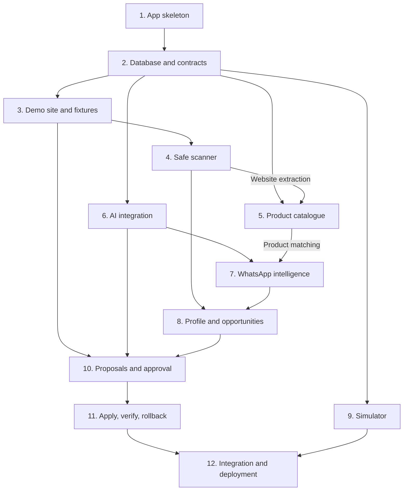

# GrowthPulse implementation plan

This plan turns [the project overview](project%20overview.md) into incremental
coding checkpoints. It preserves the core MVP scope while making prerequisites,
dependencies, and completion criteria explicit.

Build one checkpoint at a time. Do not move to a dependent checkpoint until its
prerequisites pass their acceptance checks. This is a build plan, not a record of
implemented features.

## Starting point and scope

The repository currently contains the product specification, with no application
implementation.

Build the central experience:

**Understand -> Discover -> Simulate -> Improve -> Approve -> Verify -> Learn**

Use the controlled Urban Threads business and synthetic conversations for the
demo. Defer live WhatsApp, marketplace, and analytics integrations. Keep website
scanning, product imports, and conversation imports usable independently.

The main ordering changes from the overview are:

- Establish database contracts and business ownership before private imports.
- Build the controlled demo website and sample data before scanning it.
- Establish the reusable AI boundary before conversation analysis.
- Record evidence and activity as features are built, not at the end.
- Treat the simulator as independent of AI and improvement execution.

## Prerequisites

| Prerequisite | What to prepare or learn | Required by |
|---|---|---|
| JavaScript | Objects, arrays, functions, modules, promises, async/await, error handling | Checkpoint 1 |
| TypeScript | Types, interfaces, unions, optional fields, narrowing | Checkpoint 1 |
| React | Components, props, state, forms, effects | Checkpoint 1 |
| HTTP and Express | Requests, responses, methods, status codes, middleware | Checkpoint 1 |
| Local development tools | Git, Node.js, npm, editor | Checkpoint 1 |
| SQL and MySQL | Running MySQL server, tables, keys, joins, transactions, migrations | Checkpoint 2 |
| Anthropic access | Server-side API key, available model, billing and spend limit | Real AI calls in checkpoint 6 |
| Browser verification | Playwright browser binaries and a supported execution environment | Checkpoint 11 |
| Hosting capabilities | Verify the specific GoDaddy plan rather than assuming support | Investigate early; required for checkpoint 12 |

The overview specifies Node.js 22. Use it consistently locally, in CI, and on
hosting, or explicitly revise that choice after checking compatibility. The
development machine had Node.js 24.18.0 when this plan was prepared; do not assume
that matches the target runtime.

Live WhatsApp access, marketplace credentials, real customer conversations, and
real analytics are not prerequisites for starting. Clearly label synthetic data
and simulated metrics.

## Dependency map



The map shows the complete demonstration path. Individual import and analysis
features must still support missing optional channels. The numbered order is a
recommended learning sequence, not a reason to introduce artificial dependencies.

## Checkpoint 1: Working application skeleton

**Depends on:** local Node.js, npm, and Git setup.

### Build

- React, Vite, TypeScript, and Tailwind frontend.
- Express and TypeScript backend.
- Basic application navigation.
- `GET /api/health`, called successfully from the frontend.
- Environment-variable validation and a secret-safe `.env.example`.
- `.gitignore`, basic error handling, and build, type-check, and test commands.

**Learn:** browser versus server, React components, HTTP, environment variables.

**Acceptance:** one command starts development, the UI displays backend health,
and production builds succeed. No database or AI is required yet.

## Checkpoint 2: Database, business ownership, and shared contracts

**Depends on:** checkpoint 1 and a running MySQL server.

### Build

- MySQL connection pool and versioned migrations.
- Manual business creation, editing, and retrieval.
- Zod request/response schemas and shared data shapes.
- A consistent evidence-reference model, including source, record or page
  reference, and capture time.
- Business ownership checks before private imports.
- Activity recording for important actions.

A local demo may use a deliberately restricted demo identity. Real private data
requires authentication and server-side authorization; a business ID supplied by
the browser is not proof of ownership.

**Learn:** SQL, migrations, runtime validation, authorization versus authentication.

**Acceptance:** business data survives restart, invalid requests are rejected,
and changing business or record identifiers cannot expose another owner's data.

## Checkpoint 3: Controlled demo website and sample datasets

**Depends on:** checkpoint 2.

### Build

- Urban Threads homepage, catalogue, product details, and contact page.
- Editable website content stored as structured configuration.
- Synthetic product and conversation fixtures.
- Intentional missing size and delivery information for the demonstration.
- Repeatable seed/reset functionality restricted to development or demo data.

**Learn:** fixtures, reproducible debugging, configuration-driven rendering.

**Acceptance:** the same starting business, dataset, and website can be restored
reliably without deleting unrelated data.

**Why now:** scanning, extraction, recommendations, and verification need a stable
target before their implementation begins.

## Checkpoint 4: Website onboarding and safe scanning

**Depends on:** checkpoints 2 and 3.

### Build

- Website URL onboarding, while preserving manual onboarding.
- Same-domain scanning limited to five pages.
- Extraction with Cheerio and persisted evidence with URLs and scan timestamps.
- Loading, partial-result, and failure states.
- Destination validation at connection time and for each redirect.
- Blocking of private/local addresses and cloud metadata endpoints.
- Request timeouts, response-size limits, and crawl limits.

Do not weaken the public scanner to reach localhost. Use an isolated fixture
transport for tests or host the demo on an allowed public address. Cheerio
extracts HTML; it does not prove rendered mobile layout quality.

**Learn:** fetching HTML, URL handling, parsing, bounded asynchronous work.

**Acceptance:** an allowed public demo site produces traceable extracted evidence;
unsafe destinations and redirects are rejected; manual onboarding still works.

## Checkpoint 5: Unified product catalogue

**Depends on:** checkpoint 2; website extraction additionally depends on checkpoint 4.

### Build

- Manual product creation and editing.
- Validated CSV import with useful row-level errors.
- Website product extraction connected to the same catalogue.
- Source-specific listings preserved separately from canonical products.
- Identifier-based confident matches and owner confirmation for uncertain matches.
- Repeat-import handling that avoids uncontrolled duplicates.

Never silently merge products merely because their names are similar. Preserve
source-specific price, currency, variants, and availability rather than inventing
or overwriting values.

**Learn:** parsing, normalization, relational modelling, deduplication.

**Acceptance:** manual, CSV, and website products coexist with source attribution;
invalid rows have actionable errors; repeated imports behave predictably.

## Checkpoint 6: Reusable AI integration

**Depends on:** checkpoint 2 and Anthropic credentials for real calls.

### Build

- A server-only service using the official Anthropic TypeScript SDK.
- Structured responses validated with Zod.
- Timeouts, bounded retries for transient errors, and explicit failure reporting.
- Input/output limits and spending safeguards.
- Logs that exclude API keys and private conversation content.
- Evidence IDs in AI outputs, checked against actual server-side records.
- A clear separation between live AI responses and test/demo fixtures.

Treat imported website and conversation content as untrusted data, not
instructions. Invalid output must not become a successful analysis.

**Learn:** external APIs, structured outputs, dependency injection, failure handling.

**Acceptance:** a small real request returns validated output. Missing credentials,
malformed responses, and timeouts produce honest errors. Fixtures are never
presented as live AI analysis.

## Checkpoint 7: WhatsApp imports and conversation intelligence

**Depends on:** checkpoints 2 and 6; product matching uses checkpoint 5.

### Build

- A documented CSV/JSON format before implementing import.
- Conversation/message identifiers, sender roles, timestamps, and message text.
- Validated imports, deduplication, and conversation browsing.
- Categorization, common questions, and evidence-backed unresolved enquiries.
- Product matching that preserves uncertainty.
- Suggested replies using confirmed business information.

Use synthetic or authorized data only. Do not implement message sending in the
MVP.

**Learn:** import pipelines, aggregation, ambiguous data handling.

**Acceptance:** synthetic conversations produce traceable insights; unknown
products remain unknown; repeated imports are controlled; no messages can be sent.

## Checkpoint 8: Unified profile and opportunity discovery

**Depends on:** checkpoints 4-7 for the complete demo; missing channels must be supported.

### Build

- An editable business profile combining available evidence.
- Explicit separation of owner-confirmed facts and AI hypotheses.
- Up to five prioritized opportunities.
- Verified evidence references for each opportunity.
- Transparent backend ranking using impact, evidence strength, effort,
  confidence, and relevance.

Do not accept an unexplained AI score as the ranking system or invent missing
channel data.

**Learn:** data provenance, aggregation, deterministic scoring.

**Acceptance:** an opportunity links an actual imported conversation question to
missing website information. Analysis still works when an optional channel is
absent, and insufficient evidence is reported honestly.

## Checkpoint 9: Deterministic growth simulator

**Depends on:** checkpoint 2. AI is not required.

### Build

- Backend baseline/scenario calculations.
- Editable inputs and scenario comparison UI.
- Explicit units for conversion percentage, currency, and costs.
- A defined variable-cost model: monthly totals or costs calculated from sales.
- Validation and handling of percentage change from a zero baseline.
- Visible assumptions and simulation labels.

Use:

```text
Revenue = Visitors * (Conversion Percentage / 100) * Average Order Value
Profit = Revenue - Variable Costs - Fixed Costs
```

Keep all values on the same time basis. AI explanations are optional; arithmetic
must remain deterministic backend code.

**Learn:** pure functions, numerical validation, focused unit tests.

**Acceptance:** known examples calculate correctly, invalid inputs are rejected,
zero baselines never cause division by zero, and hypothetical assumptions are
clearly labelled.

## Checkpoint 10: Proposed improvements and approval

**Depends on:** checkpoints 3, 6, and 8. The simulator is not a technical prerequisite.

### Build

- One permitted improvement type first, such as a size-guide section.
- Structured content/configuration changes, not executable code or arbitrary HTML.
- Stored proposals with evidence and original configuration versions.
- Before/after preview.
- Owner approval and rejection of an exact proposal version.
- Invalidation of prior approval when a proposal changes.

Do not invent product measurements or business policies to fill missing content.
Require confirmed business information where needed.

**Learn:** state machines, versioning, safe rendering.

**Acceptance:** owners can preview, approve, or reject a proposal; generation and
preview alone never mutate the website; a changed proposal requires new approval.

## Checkpoint 11: Apply, verify, and roll back

**Depends on:** checkpoint 10 and a working Playwright environment.

### Build

- Execution restricted to approved proposals on the controlled demo website.
- Original configuration saved before mutation.
- Stale-proposal rejection and duplicate-execution prevention.
- Genuine before/after screenshots.
- Checks for page load, expected content, CTA visibility, mobile overflow,
  important content visibility, and critical console errors.
- Persisted verification reports and activity history.
- Rollback that does not overwrite newer unrelated changes.

Plan for failures between saving, applying, and verifying. An interrupted or
failed verification must remain distinguishable from a passed verification.

**Learn:** transactions, idempotency, browser testing, recovery.

**Acceptance:** the full approval-to-verification path works, unapproved execution
is blocked, failed checks never appear as success, and rollback restores the
correct version safely.

Technical checks do not prove increased sales or revenue.

## Checkpoint 12: Integration, deployment, and handover

**Depends on:** all required feature checkpoints and verified hosting capabilities.

### Build

- Dashboard summaries backed by real stored results.
- CI, setup instructions, and production build/start commands.
- Complete access controls before using real private data.
- Upload limits, retention/deletion handling, and safe production configuration.
- End-to-end tests for the full demonstration and important failure paths.
- Environment setup and demo/reset documentation.

Verify the specific GoDaddy plan supports:

- The selected Node.js runtime and a persistent application process.
- MySQL connectivity and outbound API calls.
- HTTPS and secure environment-variable configuration.
- Required storage and any long-running work.
- Playwright browser execution, if verification will run there.

If browser execution is unsupported, use an authenticated worker or CI environment
and report real asynchronous job status. Do not assume hosting supports browser
binaries or display fake completion.

**Learn:** production configuration, CI, deployment, operational failure handling.

**Acceptance:** a fresh setup can run the demo end-to-end without manual database
edits; production serves the built frontend through Express using
`process.env.PORT`; secrets never reach the frontend; deployed limitations are
documented honestly.

## Dependency adoption

Add packages when their checkpoint needs them, not all at once.

| Stage | Dependencies or tooling |
|---|---|
| Application skeleton | React, Vite, TypeScript, Tailwind, Express, Zod, development runner and test tooling |
| Persistence | MySQL server, mysql2, a selected migration mechanism |
| Website extraction | Cheerio and a bounded HTTP-fetch implementation |
| Imports | A maintained CSV parser; JSON parsing with schema validation |
| AI | Official Anthropic TypeScript SDK |
| Verification | Playwright and its browser binaries |

Commit the package lockfile and align compatible package/runtime versions. Choose
one migration mechanism and one test runner rather than duplicating tools.

## Completion report for every checkpoint

Before starting, explain the files/modules to create or modify. At completion,
record:

- What was implemented and which acceptance checks passed.
- Files changed, APIs added, and database migrations.
- Environment variables and external prerequisites.
- Tests run and their actual results.
- How to run and manually check the feature.
- Remaining limitations and the next dependency-ready checkpoint.

Start with checkpoint 1 only. The first meaningful milestone is a working
UI-to-API-to-database flow. The next is importing and displaying evidence before
asking AI to interpret it.
