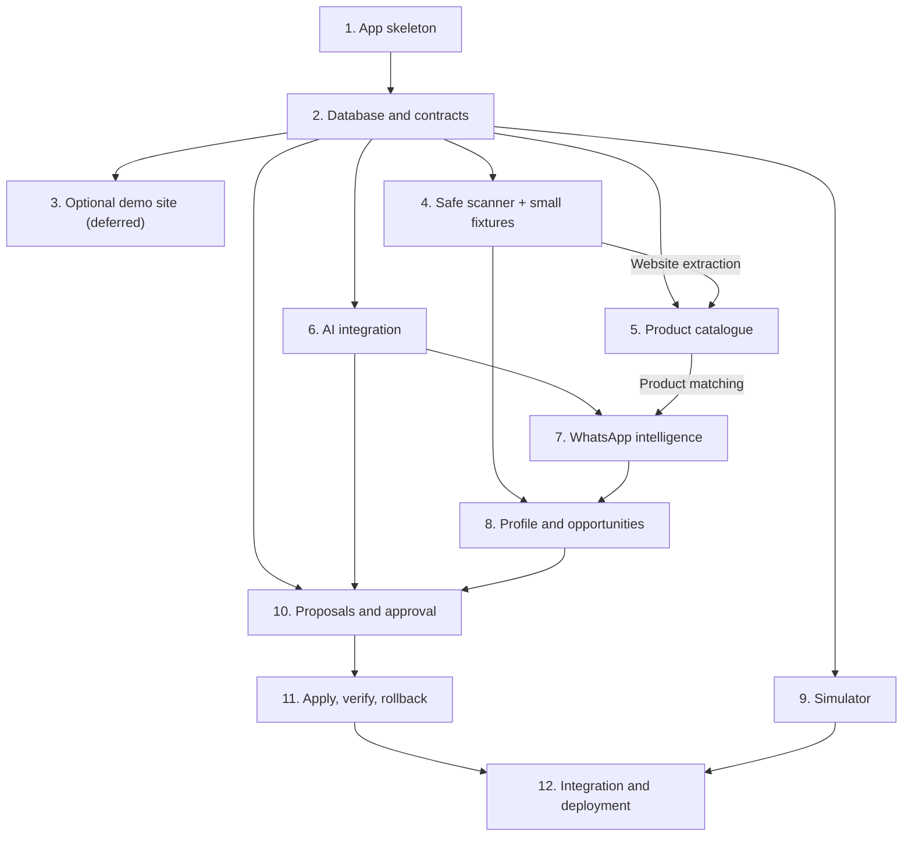

# GrowthPulse implementation plan

This plan turns [the project overview](project%20overview.md) into incremental
coding checkpoints. It preserves the core MVP scope while making prerequisites,
dependencies, and completion criteria explicit.

Build one checkpoint at a time. Do not move to a dependent checkpoint until its
prerequisites pass their acceptance checks. This is a build plan, not a record of
implemented features.

## Starting point and scope

Checkpoints 1, 2, 4, and 5 are implemented locally: the application shell, health API,
SQLite persistence, signup/login/logout, owner-scoped business profiles, and
activity/evidence references, plus manual public website scans with saved
results, plus a manual catalogue and reviewed CSV/saved-website product imports.
The full demo storefront (checkpoint 3) is deferred by owner choice; small
isolated scanner fixtures remain. Later feature checkpoints and GoDaddy
hosting verification remain planned. MySQL persistence is now implemented.
A bounded agent-led onboarding layer now uses the
official Anthropic SDK and scanner tool; live use requires a server-side key.
The local research foundation now adds LangGraph orchestration and hosted,
search-only Tavily MCP. This does not mark the remaining feature checkpoints
complete.

### Implemented local research foundation

The durable SQL queue and in-process worker now coordinate Store,
Competitor, Customer, Pricing, Product Opportunity and Growth Strategy roles.
Independent branches overlap; dependent analyses wait for their evidence.
Specialist findings and usage are saved independently under the worker's lease,
with SQL graph checkpoints and explicit retry/reuse of matching
artifacts. Changed inputs invalidate downstream analyses. The interface exposes
one specialist panel at a time and preserves findings across reload/cancellation.
Suggestions never automatically modify the owner profile or catalogue.

Tavily discovery is included in every new UI analysis under a combined
business/competitor approval and requires a local server-side `TAVILY_API_KEY`.
Automatic onboarding includes it after that approval; the initial public scan
still makes no AI or Tavily requests, and existing reports are not rerun
automatically. The hosted connection
has not been live-verified. Search leads are rechecked with the existing safe
scanner before becoming evidence. Current per-attempt caps allow six basic
searches, six competitor sites, five importable products per site, fourteen model
calls and ten minutes. Older jobs retain their original budgets. These are conservative implementation defaults, not
account-wide free-tier or monthly billing guarantees. Competitor products remain
research evidence, not merchant catalogue imports.

Customer Intelligence deliberately reports evidence gaps until a permitted
individual-review connector exists. Pricing is a deterministic GTIN/dated-offer
observation, not a fully qualified price-advantage calculation. Opportunity and
Growth propose experiments, not verified demand or performance. Remaining work
includes live provider verification, review-source permissions/integration and
production TLS connectivity and persistent-worker behavior on the selected
GoDaddy host. The MySQL queue/journal/checkpointer is implemented and checked
against disposable real MySQL. See README for configuration and deployment limits.

**Approved local database adjustment:** use file-based SQLite now, without
Docker or a database server. GoDaddy-managed MySQL remains the production target.
The shared asynchronous stores now support a `mysql2` pool and versioned
MySQL-specific migrations, not just a connection-string change. Production
defaults to MySQL, requires HTTPS, and still rejects SQLite. The approved hosted
database starts fresh; existing local data is not automatically transferred.

**Required application host:** the selected GoDaddy Node.js hosting option.
Express runs the backend and serves the built React frontend. Architecture and
dependency choices must fit that environment; do not switch providers without
explicit approval. Local or CI browser verification does not change this host.

Build the central experience:

**Understand -> Discover -> Simulate -> Improve -> Approve -> Verify -> Learn**

Use permitted public pages for read-only dry runs and small synthetic fixtures
for repeatable tests instead of building the Urban Threads demo storefront now.
Defer live WhatsApp, marketplace, and analytics integrations. Keep website
scanning, product imports, and conversation imports usable independently.

The main ordering changes from the overview are:

- Establish database contracts and business ownership before private imports.
- Test scanning with isolated synthetic transport fixtures and permitted public
  targets; a complete demo website is not a scanner prerequisite.
- Establish the reusable AI boundary before conversation analysis.
- Record evidence and activity as features are built, not at the end.
- Treat the simulator as independent of AI and improvement execution.

## Prerequisites

| Prerequisite | What to prepare or learn | Required by |
|---|---|---|
| JavaScript | Objects, arrays, functions, modules, promises, async/await, error handling | Checkpoint 1 |
| TypeScript | Types, interfaces, unions, optional fields, narrowing | Checkpoint 1 |
| React | Components, props, state, forms, effects | Checkpoint 1 |
| HTTP and Express | Requests, responses, methods, status codes, middleware | Checkpoint 1 |
| Local development tools | Git, Node.js, npm, editor | Checkpoint 1 |
| SQL and local SQLite | Tables, keys, joins, transactions, versioned migrations; no separate server needed | Checkpoint 2 |
| GoDaddy MySQL | Verify plan/access, connection pool, MySQL migrations, data transfer, and compatibility tests | Before production deployment |
| Anthropic access | Server-side API key, available model, billing and spend limit | Real AI calls in checkpoint 6 |
| Tavily access | Optional server-side key, current credit/billing controls and explicit public research consent | Live competitor discovery |
| Browser verification | Playwright browser binaries and a supported execution environment | Checkpoint 11 |
| Hosting capabilities | Verify the specific GoDaddy plan rather than assuming support | Investigate early; required for checkpoint 12 |

The overview specifies Node.js 22. Use it consistently locally, in CI, and on
hosting, or explicitly revise that choice after checking compatibility. The
development machine had Node.js 24.18.0 when this plan was prepared; do not assume
that matches the target runtime.

Live WhatsApp access, marketplace credentials, real customer conversations, and
real analytics are not prerequisites for starting. Clearly label synthetic data
and simulated metrics.

## Dependency map



The map shows the complete demonstration path. Individual import and analysis
features must still support missing optional channels. The numbered order is a
recommended learning sequence, not a reason to introduce artificial dependencies.

## Checkpoint 1: Working application skeleton

**Depends on:** local Node.js, npm, and Git setup.

### Build

- React, Vite, TypeScript, and Tailwind frontend.
- Express and TypeScript backend.
- Basic application navigation.
- `GET /api/health`, called successfully from the frontend.
- Environment-variable validation and a secret-safe `.env.example`.
- `.gitignore`, basic error handling, and build, type-check, and test commands.

**Learn:** browser versus server, React components, HTTP, environment variables.

**Acceptance:** one command starts development, the UI displays backend health,
and production builds succeed. No database or AI is required yet.

## Checkpoint 2: Database, business ownership, and shared contracts

**Depends on:** checkpoint 1. SQLite runs inside the local Node.js application.

### Build

- Local SQLite storage and versioned, transactional migrations.
- Signup, login, logout, hashed passwords, and expiring server-side sessions.
- Protected business pages/APIs; leave the overview public for future account-free scanning.
- Manual business creation, editing, and retrieval.
- Zod request/response schemas and shared data shapes.
- A consistent evidence-reference model, including source, record or page
  reference, and capture time.
- Business ownership checks before private imports.
- Activity recording for important actions.

Every saved business belongs to its authenticated owner; a business ID supplied
by the browser is not proof of ownership. Use synthetic/test data locally.
Email verification, password recovery, retention/deletion policies, production
rate-limiter/proxy configuration, and live hosting verification remain pre-deployment work.

**Learn:** SQL, migrations, runtime validation, authorization versus authentication.

**Acceptance:** business data survives restart, invalid requests are rejected,
and changing business or record identifiers cannot expose another owner's data.
Logout/expiry revoke access, cross-origin writes are rejected, and business,
evidence, and activity writes succeed or roll back together.

## Checkpoint 3: Controlled demo website and sample datasets

**Depends on:** checkpoint 2.

**Deferred by owner choice:** do not build the full storefront now. Use permitted
public websites for read-only dry runs and isolated synthetic scanner fixtures
for repeatable tests. Keep future product/conversation fixtures small and clearly
synthetic. This checkpoint is not a prerequisite for checkpoint 4.

### Build

- Urban Threads homepage, catalogue, product details, and contact page.
- Editable website content stored as structured configuration.
- Synthetic product and conversation fixtures.
- Intentional missing size and delivery information for the demonstration.
- Repeatable seed/reset functionality restricted to development or demo data.

**Learn:** fixtures, reproducible debugging, configuration-driven rendering.

**Acceptance:** the same starting business, dataset, and website can be restored
reliably without deleting unrelated data.

Future website-change execution still requires an authorized, writable test or
staging target. Permission to read a public page is not permission to change it.

## Checkpoint 4: Website onboarding and safe scanning

**Depends on:** checkpoint 2 and small isolated scan fixtures, not a full demo site.

**Implemented locally:** the public Website screen supports account-free previews
or owner-scoped saved scans. The separate business agent can now invoke this
scanner automatically after a profile save with explicit scan/AI permission.

### Build

- Website URL onboarding, while preserving manual onboarding.
- Same-domain discovery limited to 20 page attempts, balancing business,
  collection and product coverage using safe links and published sitemaps.
- Extraction with Cheerio and persisted evidence with URLs and scan timestamps.
- Loading, partial-result, and failure states.
- Destination validation at connection time and for each redirect.
- Blocking of private/local addresses and cloud metadata endpoints.
- Request timeouts, response-size limits, and crawl limits.
- Explicit scan permission, robots.txt/crawl-delay enforcement, and no credentials
  forwarded to external sites.
- Static title, description, headings, contact links, CTA labels, and text
  extraction with truncation/JavaScript limitations made visible.
- Immutable saved runs, per-page evidence, scan history, and atomic activity
  recording without changing the owner-entered business profile.

The implementation allows up to 20 same-host page attempts (apex/`www`
redirects supported), three redirects per fetch, 50 total requests, 40 seconds
per scan, five seconds per DNS/request operation, 5 MiB per HTML page, and
256 KiB per robots file. Up to four 1 MiB sitemap files can discover up to
500 distinct page URLs; XML entities and unsafe destinations are rejected.
A shared 25 MiB response-body budget accounts for successful and failed reads
up to each request's cap. Retained page evidence is capped at 1,500,000 UTF-8
bytes, including at most 128 KiB / 50 Product JSON-LD records per page.
It pins validated public DNS answers to each connection, rejects query/token
URLs and custom ports, and never executes JavaScript. Only sitemap XML may
use numeric `from`/`to` pagination; this does not relax ordinary page URLs.
Sampling and coverage gaps are explicit. Advanced previews are not saved;
first-visit previews are temporarily retained for authenticated claim.
Signed-in business runs, including explicitly
failed attempts, are saved in SQLite migration 2. See README for publisher
directives, failure semantics, rate limits, API routes, and remaining limitations.

Do not weaken the public scanner to reach localhost. Use an isolated fixture
transport for tests or host the demo on an allowed public address. Cheerio
extracts HTML; it does not prove rendered mobile layout quality.

**Learn:** fetching HTML, URL handling, parsing, bounded asynchronous work.

**Acceptance:** an allowed public demo site produces traceable extracted evidence;
unsafe destinations and redirects are rejected; manual onboarding still works.

## Checkpoint 5: Unified product catalogue

**Depends on:** checkpoint 2; website extraction additionally depends on checkpoint 4.

**Implemented locally:** the owner-only Products screen supports manual editing,
UTF-8 CSV preview with row errors, and automatic Product JSON-LD catalogue population
when scans are saved to an owned business. Migration 3 preserves earlier workspace and scan data. No scheduler,
external inventory sync, or website writes are involved.

### Build

- Manual product creation and editing.
- Validated CSV import with useful row-level errors.
- Website product extraction connected to the same catalogue.
- Source-specific listings preserved separately from canonical products.
- Identifier-based confident matches and owner confirmation for uncertain matches.
- Repeat-import handling that avoids uncontrolled duplicates.

Never silently merge products merely because their names are similar. Preserve
source-specific price, currency, variants, and availability rather than inventing
or overwriting values.

Exact normalized identifiers suggest matches; ambiguous matches require an owner
decision. Stable source identities refresh the same listing, older snapshots
cannot overwrite newer observations, and committed imports can be retried
without duplicate writes. The local limits are 200 products/business, 100
rows/optional import preview, and 48 KiB/CSV. Automatic scan saving considers up to
1,000 captured static Product JSON-LD records and reports invalid, ambiguous,
conflicting, stale or over-limit records without blocking the remaining products.
Owner-edited product fields are preserved; only website source listings refresh.
Public preview claims and agent scans use the same transactional path, independently
of AI success. Legacy agent drafts synchronize from retained saved evidence without
network or AI calls. A prominent manual-add option covers missed products; CSV
and saved-scan review are optional bulk/repair tools. Names/prices are never guessed
from page text. See README for the CSV format, source identities, and retained drafts.

**Learn:** parsing, normalization, relational modelling, deduplication.

**Acceptance:** manual, CSV, and website products coexist with source attribution;
invalid rows have actionable errors; repeated imports behave predictably.

## Checkpoint 6: Reusable AI integration

**Depends on:** checkpoint 2 and Anthropic credentials for real calls.

**Implemented locally for business onboarding:** official Anthropic TypeScript
SDK, a fixed-destination `scan_website` tool call followed by a validated
`propose_business` call, server-issued evidence IDs resolved to original page
URLs and exact supplied excerpts, and a briefing-first result
with a sourced business summary, supported observations and their significance,
explicit unknowns, and recommended next checks. The result separates marketing
claims from verified facts and does not invent performance or checkout findings.
The Overview first-visit journey is website URL plus scan permission, readable
public-site findings without an account or AI, then a separate save/provider
consent CTA and authentication. A bounded 30-minute server-side preview
(migration 6; opaque HttpOnly cookie, 50 previews maximum, 2 MiB each) carries
the exact captured scan across sign-in without accepting browser-submitted evidence.
Authenticated, account-bound idempotent claiming creates or reuses the owner's
profile without overwriting existing details. The agent reuses that saved scan:
there is no second network scan. The briefing presents one card at a time:
business snapshot, individual observations, evidence gaps, and recommended next
moves. Readers control navigation; cards do not auto-advance. New streaming text
and final validation preserve the selected card, and source quotes/reasons
expand on demand. Subtle entry transitions respect reduced-motion preferences.
Card navigation is local, with no additional provider calls. Context correction
remains optional with one save.
Refresh does not automatically start paid AI; failed or empty scans cannot proceed.
Manual entry remains an alternative, not a prerequisite.
Briefings persist in the existing owner-scoped review JSON (migration 4).
Older profile-only results are labelled honestly and require an explicit new
analysis for a briefing; there is no automatic paid backfill.
New runs stream provisional briefing text from the SDK's eager tool-input stream,
including unfinished strings, then validate citations and save only the final
result. Real phase updates replace a silent wait; incomplete or failed streams
are errors, not completed analyses, and are never automatically retried. Previous
saved results remain available after failures. Technical scan notes are removed
from the briefing; saved scan diagnostics remain in Website.
Explicit provider/scan consent and a single-step
editable profile approval with durable completion (migration 5), plus the existing
reviewed CSV imports and automatic scanned-product catalogues. Previously applied suggestions do not become pending
again after reload or a later manual edit. Profiles save before AI starts;
AI never silently overwrites owner fields or invents catalogue products; deterministic
scan saving adds valid website records without an import confirmation. Missing keys,
invalid outputs and blocked pages are reported honestly. At most two provider
calls (256 output tokens for the scanner request and 4,096 for the briefing),
no retries, 30-second provider timeouts and a
120-second processing deadline bound work, excluding queue wait. Website/account
authorization, all scanner restrictions, and shared scan limits remain enforced.
No arbitrary tool execution is introduced.
The response budget is reallocated within the previous 4,400-token total ceiling.
Output-limit failures are explicit, log only safe completion metadata and never
replace a prior saved briefing. An explicit onboarding retry reuses its saved scan.

Local briefings now use a durable SQLite queue (migration 8) and a single worker
inside the API process. Permissioned POST returns a job ID immediately; separate
authenticated GET streams restore actual phases and provisional cards after
navigation or refresh. Disconnecting a viewer does not cancel background work.
Cancellation is explicit. Final briefing and job completion
commit atomically; failed/cancelled work cannot replace a prior saved briefing.
Products are already persisted atomically with the permissioned website scan.
Request UUIDs bind retries to the original URL and input scan. One active job per
business and one running worker job across SQLite connections prevent overlap;
the worker shares the local process's two-operation foreground scan budget.
Queue capacity is 50, queued work expires after 15 minutes when the worker checks,
and running work uses renewable 30-second leases. Queued work survives restart;
stopped/expired running work becomes interrupted, never automatically repeated
at the AI provider. Explicit retries reuse saved matching scan checkpoints.
Provider charges can precede crashes, so exactly-once billing is not guaranteed.
GET viewers rotate every 20 seconds and reconnect without paid POST retries.
This improves resilience, not generation speed or zero-wait guarantees.
MySQL queue storage, leases, journal and checkpoints are implemented. GoDaddy
TLS and persistent-worker hosting verification remain deployment prerequisites;
production SQLite startup stays blocked.

The scanner tool now supplies up to 256 KiB of balanced page evidence and
100 structured product records, including published offers, variants,
materials, ratings claims, headings and CTAs. The agent is instructed to assess
supported marketing positioning and buying confidence, not invent private
performance data. Supplied/captured counts and clipping limitations accompany
the evidence and appear in a collapsed saved-briefing summary. Exact-quote
checks use only the evidence actually sent to the provider, not omitted scan
content. The concise card/output limits are unchanged; larger captured
catalogues may exceed the existing 100-row reviewed product-import limit
without preventing a product-informed briefing.

Automated validation uses injected scanner/provider fixtures. A live acceptance
request and provider-side billing/spend configuration still require the owner's
Anthropic credentials; this is not a claim that later AI modules are complete.

### Build

- A server-only service using the official Anthropic TypeScript SDK.
- Structured responses validated with Zod.
- Timeouts, bounded retries for transient errors, and explicit failure reporting.
- Input/output limits and spending safeguards.
- Logs that exclude API keys and private conversation content.
- Evidence IDs in AI outputs, checked against actual server-side records.
- A clear separation between live AI responses and test/demo fixtures.

Treat imported website and conversation content as untrusted data, not
instructions. Invalid output must not become a successful analysis.

**Learn:** external APIs, structured outputs, dependency injection, failure handling.

**Acceptance:** a small real request returns validated output. Missing credentials,
malformed responses, and timeouts produce honest errors. Fixtures are never
presented as live AI analysis.

## Checkpoint 7: WhatsApp imports and conversation intelligence

**Depends on:** checkpoints 2 and 6; product matching uses checkpoint 5.

### Build

- A documented CSV/JSON format before implementing import.
- Conversation/message identifiers, sender roles, timestamps, and message text.
- Validated imports, deduplication, and conversation browsing.
- Categorization, common questions, and evidence-backed unresolved enquiries.
- Product matching that preserves uncertainty.
- Suggested replies using confirmed business information.

Use synthetic or authorized data only. Do not implement message sending in the
MVP.

**Learn:** import pipelines, aggregation, ambiguous data handling.

**Acceptance:** synthetic conversations produce traceable insights; unknown
products remain unknown; repeated imports are controlled; no messages can be sent.

## Checkpoint 8: Unified profile and opportunity discovery

**Depends on:** checkpoints 4-7 for the complete demo; missing channels must be supported.

### Build

- An editable business profile combining available evidence.
- Explicit separation of owner-confirmed facts and AI hypotheses.
- Up to five prioritized opportunities.
- Verified evidence references for each opportunity.
- Transparent backend ranking using impact, evidence strength, effort,
  confidence, and relevance.

Do not accept an unexplained AI score as the ranking system or invent missing
channel data.

**Learn:** data provenance, aggregation, deterministic scoring.

**Acceptance:** an opportunity links an actual imported conversation question to
missing website information. Analysis still works when an optional channel is
absent, and insufficient evidence is reported honestly.

## Checkpoint 9: Deterministic growth simulator

**Depends on:** checkpoint 2. AI is not required.

### Build

- Backend baseline/scenario calculations.
- Editable inputs and scenario comparison UI.
- Explicit units for conversion percentage, currency, and costs.
- A defined variable-cost model: monthly totals or costs calculated from sales.
- Validation and handling of percentage change from a zero baseline.
- Visible assumptions and simulation labels.

Use:

```text
Revenue = Visitors * (Conversion Percentage / 100) * Average Order Value
Profit = Revenue - Variable Costs - Fixed Costs
```

Keep all values on the same time basis. AI explanations are optional; arithmetic
must remain deterministic backend code.

**Learn:** pure functions, numerical validation, focused unit tests.

**Acceptance:** known examples calculate correctly, invalid inputs are rejected,
zero baselines never cause division by zero, and hypothetical assumptions are
clearly labelled.

## Checkpoint 10: Proposed improvements and approval

**Depends on:** checkpoints 6 and 8, business ownership, and an authorized writable
test/staging target. The optional checkpoint 3 storefront and simulator are not
technical prerequisites.

### Build

- One permitted improvement type first, such as a size-guide section.
- Structured content/configuration changes, not executable code or arbitrary HTML.
- Stored proposals with evidence and original configuration versions.
- Before/after preview.
- Owner approval and rejection of an exact proposal version.
- Invalidation of prior approval when a proposal changes.

Do not invent product measurements or business policies to fill missing content.
Require confirmed business information where needed.

**Learn:** state machines, versioning, safe rendering.

**Acceptance:** owners can preview, approve, or reject a proposal; generation and
preview alone never mutate the website; a changed proposal requires new approval.

## Checkpoint 11: Apply, verify, and roll back

**Depends on:** checkpoint 10 and a working Playwright environment.

### Build

- Execution restricted to approved proposals on an authorized, controlled
  test/staging website, never arbitrary third-party scan targets.
- Original configuration saved before mutation.
- Stale-proposal rejection and duplicate-execution prevention.
- Genuine before/after screenshots.
- Checks for page load, expected content, CTA visibility, mobile overflow,
  important content visibility, and critical console errors.
- Persisted verification reports and activity history.
- Rollback that does not overwrite newer unrelated changes.

Plan for failures between saving, applying, and verifying. An interrupted or
failed verification must remain distinguishable from a passed verification.

**Learn:** transactions, idempotency, browser testing, recovery.

**Acceptance:** the full approval-to-verification path works, unapproved execution
is blocked, failed checks never appear as success, and rollback restores the
correct version safely.

Technical checks do not prove increased sales or revenue.

## Checkpoint 12: Integration, deployment, and handover

**Depends on:** all required feature checkpoints and verified hosting capabilities.

### Build

- Dashboard summaries backed by real stored results.
- CI, setup instructions, and production build/start commands.
- Complete access controls before using real private data.
- Upload limits, retention/deletion handling, and safe production configuration.
- End-to-end tests for the full demonstration and important failure paths.
- Environment setup and demo/reset documentation.
- Implemented: shared asynchronous SQLite/MySQL stores, a connection pool,
  MySQL-specific checked migrations and real MySQL compatibility checks.
  Verify live GoDaddy connectivity/TLS and restart behavior before publishing.
  Start with the approved fresh hosted database; keep local data unchanged.
  Any later data transfer is a separate, backed-up migration.

Verify the specific GoDaddy plan supports:

- The selected Node.js runtime and a persistent application process.
- MySQL connectivity and outbound API calls.
- HTTPS and secure environment-variable configuration.
- Required storage and any long-running work.
- Playwright browser execution, if verification will run there.

If browser execution is unsupported, use an authenticated worker or CI environment
and report real asynchronous job status. Do not assume hosting supports browser
binaries or display fake completion.

**Learn:** production configuration, CI, deployment, operational failure handling.

**Acceptance:** a fresh setup can run the demo end-to-end without manual database
edits; production serves the built frontend through Express using
`process.env.PORT`; secrets never reach the frontend; deployed limitations are
documented honestly.

## Dependency adoption

Add packages when their checkpoint needs them, not all at once.

| Stage | Dependencies or tooling |
|---|---|
| Application skeleton | React, Vite, TypeScript, Tailwind, Express, Zod, development runner and test tooling |
| Local persistence and identity | better-sqlite3, versioned SQLite migrations, Node scrypt, express-rate-limit |
| Production persistence | GoDaddy MySQL, mysql2 connection pool, MySQL-specific migrations and integration checks |
| Website extraction | Cheerio, ipaddr.js, robots-parser, and bounded DNS-pinned Node HTTP(S) requests |
| Imports | A maintained CSV parser; JSON parsing with schema validation |
| AI | Official Anthropic TypeScript SDK |
| Verification | Playwright and its browser binaries |

Commit the package lockfile and align compatible package/runtime versions. Choose
one migration mechanism and one test runner rather than duplicating tools.

## Completion report for every checkpoint

Before starting, explain the files/modules to create or modify. At completion,
record:

- What was implemented and which acceptance checks passed.
- Files changed, APIs added, and database migrations.
- Environment variables and external prerequisites.
- Tests run and their actual results.
- How to run and manually check the feature.
- Remaining limitations and the next dependency-ready checkpoint.

The local UI-to-API-to-database and safe manual scanning milestones are
implemented. The owner deferred the full demo storefront; isolated fixtures
provide reproducible scanner checks. Continue with checkpoint 5's unified product
catalogue and source-preserving imports, then checkpoint 6's AI boundary.
GoDaddy runtime configuration, live TLS/health and persistent-worker verification,
plus the documented public-launch hardening, remain required before deployment.
